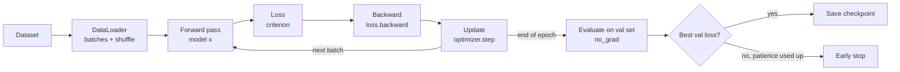

A reusable skeleton for supervised training in PyTorch. Copy it, swap in your own data and model, and keep the loop. Every epoch it records train and validation loss and accuracy in a `history` dict; [[Loss Curve Plotting Snippets]] turns that dict into plots. For how PyTorch compares with the Keras workflow used in [[Autoencoder Snippets]], see [[Keras vs. PyTorch vs. TensorFlow]].



## Setup: Imports, Seed, Device

Fixing the seeds makes runs repeatable, and picking the device once lets the same code run on CPU, CUDA, or Apple Silicon (MPS).

```python
import random, numpy as np, torch, torch.nn as nn
from torch.utils.data import Dataset, DataLoader, random_split

def set_seed(seed=42):
    random.seed(seed); np.random.seed(seed); torch.manual_seed(seed)
    torch.cuda.manual_seed_all(seed)

set_seed(42)
device = (
    "cuda" if torch.cuda.is_available()
    else "mps" if torch.backends.mps.is_available()
    else "cpu"
)
```

## Dataset and DataLoader

A `Dataset` answers two questions: how many samples there are (`__len__`) and what sample `i` is (`__getitem__`). A `DataLoader` wraps it to batch, shuffle, and load in parallel. Shuffle only the training set.

```python
class TabularDataset(Dataset):
    def __init__(self, X, y):
        self.X = torch.as_tensor(X, dtype=torch.float32)
        self.y = torch.as_tensor(y, dtype=torch.long)     # float32 for regression
    def __len__(self):
        return len(self.X)
    def __getitem__(self, i):
        return self.X[i], self.y[i]

full = TabularDataset(X, y)
n_val  = int(0.15 * len(full))
n_test = int(0.15 * len(full))
train_ds, val_ds, test_ds = random_split(
    full, [len(full) - n_val - n_test, n_val, n_test],
    generator=torch.Generator().manual_seed(42),
)

train_loader = DataLoader(train_ds, batch_size=64, shuffle=True,  num_workers=2)
val_loader   = DataLoader(val_ds,   batch_size=256, shuffle=False)
test_loader  = DataLoader(test_ds,  batch_size=256, shuffle=False)
```

For images, `torchvision.datasets.ImageFolder(root, transform=...)` replaces the custom class.

## Model

Declare layers in `__init__` and connect them in `forward`. Return raw logits; `nn.CrossEntropyLoss` applies softmax internally (see [[Loss Functions]]).

```python
class MLP(nn.Module):
    def __init__(self, in_dim, hidden=128, n_classes=10, p_drop=0.2):
        super().__init__()
        self.net = nn.Sequential(
            nn.Linear(in_dim, hidden), nn.ReLU(), nn.Dropout(p_drop),
            nn.Linear(hidden, hidden), nn.ReLU(), nn.Dropout(p_drop),
            nn.Linear(hidden, n_classes),
        )
    def forward(self, x):
        return self.net(x)

model = MLP(in_dim=X.shape[1], n_classes=len(np.unique(y))).to(device)
criterion = nn.CrossEntropyLoss()                        # nn.MSELoss() for regression
optimizer = torch.optim.AdamW(model.parameters(), lr=1e-3, weight_decay=1e-4)
scheduler = torch.optim.lr_scheduler.ReduceLROnPlateau(optimizer, factor=0.5, patience=3)
```

`weight_decay` is L2-style [[Regularization]]; `Dropout` is active only in `model.train()` mode.

## One Training Epoch

The five lines inside the loop are the core of every PyTorch training script: move the batch, clear old gradients, forward, backward, step.

```python
def train_one_epoch(model, loader, criterion, optimizer, max_grad_norm=1.0):
    model.train()                                        # enables dropout / batchnorm updates
    total_loss, correct, n = 0.0, 0, 0
    for xb, yb in loader:
        xb, yb = xb.to(device), yb.to(device)
        optimizer.zero_grad()
        logits = model(xb)
        loss = criterion(logits, yb)
        loss.backward()
        nn.utils.clip_grad_norm_(model.parameters(), max_grad_norm)   # optional
        optimizer.step()

        total_loss += loss.item() * xb.size(0)           # undo the batch mean
        correct    += (logits.argmax(1) == yb).sum().item()
        n          += xb.size(0)
    return total_loss / n, correct / n
```

## Evaluation

`model.eval()` switches dropout and [[Batch Normalization]] to inference behaviour; `torch.no_grad()` skips building the autograd graph, which saves memory and time.

```python
@torch.no_grad()
def evaluate(model, loader, criterion):
    model.eval()
    total_loss, correct, n = 0.0, 0, 0
    for xb, yb in loader:
        xb, yb = xb.to(device), yb.to(device)
        logits = model(xb)
        total_loss += criterion(logits, yb).item() * xb.size(0)
        correct    += (logits.argmax(1) == yb).sum().item()
        n          += xb.size(0)
    return total_loss / n, correct / n
```

## Fit Loop with Early Stopping and Checkpointing

Keeps the weights from the epoch with the lowest validation loss and stops once validation loss has not improved for `patience` epochs.

```python
def fit(model, train_loader, val_loader, criterion, optimizer,
        scheduler=None, epochs=100, patience=10, ckpt_path="best_model.pt"):
    history = {"train_loss": [], "val_loss": [], "train_acc": [], "val_acc": []}
    best_val, bad_epochs = float("inf"), 0

    for epoch in range(1, epochs + 1):
        tr_loss, tr_acc = train_one_epoch(model, train_loader, criterion, optimizer)
        va_loss, va_acc = evaluate(model, val_loader, criterion)
        if scheduler is not None:
            scheduler.step(va_loss)                      # ReduceLROnPlateau takes the metric

        for k, v in zip(history, (tr_loss, va_loss, tr_acc, va_acc)):
            history[k].append(v)
        print(f"epoch {epoch:3d} | train {tr_loss:.4f} / {tr_acc:.3f} "
              f"| val {va_loss:.4f} / {va_acc:.3f} | lr {optimizer.param_groups[0]['lr']:.1e}")

        if va_loss < best_val - 1e-4:
            best_val, bad_epochs = va_loss, 0
            torch.save({"epoch": epoch, "model": model.state_dict(),
                        "optimizer": optimizer.state_dict()}, ckpt_path)
        else:
            bad_epochs += 1
            if bad_epochs >= patience:
                print(f"early stop at epoch {epoch}, best val loss {best_val:.4f}")
                break
    return history

history = fit(model, train_loader, val_loader, criterion, optimizer, scheduler)
```

## Restore Best Weights and Test

Report the test set exactly once, after all tuning is done on the validation set; see [[Metrics and Model Evaluation]].

```python
ckpt = torch.load("best_model.pt", map_location=device)
model.load_state_dict(ckpt["model"])
test_loss, test_acc = evaluate(model, test_loader, criterion)
print(f"test loss {test_loss:.4f} | test acc {test_acc:.3f} (best epoch {ckpt['epoch']})")
```

## Inference on New Data

```python
@torch.no_grad()
def predict(model, X_new):
    model.eval()
    logits = model(torch.as_tensor(X_new, dtype=torch.float32, device=device))
    probs = torch.softmax(logits, dim=1)
    return probs.argmax(1).cpu().numpy(), probs.cpu().numpy()
```

## Adapting the Template

| Task | Change |
| --- | --- |
| Regression | `y` as `float32` with shape `(N, 1)`, `nn.MSELoss()` or `nn.HuberLoss()`, drop the accuracy lines |
| Binary classification | One output logit, `nn.BCEWithLogitsLoss()`, predict with `(logits > 0)` |
| Images | `ImageFolder` plus `transforms`, a CNN in place of the MLP (see [[Convolutional Neural Networks]]) |
| Class imbalance | `nn.CrossEntropyLoss(weight=class_weights)` or a `WeightedRandomSampler` |
| Faster GPU training | Mixed precision with `torch.autocast(device_type="cuda")` and `torch.amp.GradScaler()` |
| Per-batch LR schedules (OneCycle, warmup) | Call `scheduler.step()` inside the batch loop instead of once per epoch |

## Common Mistakes

- **Forgetting `optimizer.zero_grad()`.** PyTorch accumulates gradients, so each step would add up all previous gradients.
- **Leaving the model in `train()` mode for evaluation.** Dropout stays on and BatchNorm keeps updating its statistics, so validation numbers are noisy and wrong.
- **Appending `loss` instead of `loss.item()`.** This keeps every batch's computation graph alive and memory grows until it runs out.
- **Applying softmax before `CrossEntropyLoss`.** The loss already includes log-softmax; doing it twice flattens the gradients.
- **Tensors on different devices.** Move both the model and every batch to `device`.

*Source: [PyTorch Tutorial: Optimizing Model Parameters](https://pytorch.org/tutorials/beginner/basics/optimization_tutorial.html), [PyTorch Docs: torch.utils.data](https://pytorch.org/docs/stable/data.html)*
