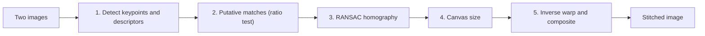

**Image stitching** joins overlapping photographs into one larger image. For two photos taken by a camera that rotates about its centre (or of a flat scene), the second photo is related to the first by a **homography**, so stitching reduces to: find matching points, estimate the homography robustly, and warp one image onto the other's frame.

The example below follows one pair of 2000 x 1500 photographs of a park at dusk through every step.

![[stitching-input-photos.jpg]]

*The two input photographs. Photo 1 is the reference and stays unchanged; photo 2 will be warped into its frame.*

## The Pipeline

| Step | What it does | Notes |
| ---- | ------------ | ----- |
| 1. Keypoints | Detect distinctive points and describe each with a vector | [[SIFT]] or a binary alternative such as [[AKAZE and Binary Descriptors]] |
| 2. Putative matches | Match each descriptor to its nearest neighbour in the other image, keep unambiguous ones | [[Feature Matching]]. Matching all pairs of keypoints would give a million candidates for a thousand keypoints per image, which is too many outliers even for RANSAC |
| 3. Homography | Fit $H$ to the matches with [[RANSAC]], then refit on all inliers | 4 point pairs per trial: [[Homographies and Perspective Warping]] |
| 4. Canvas | Choose an output size that holds both images | See below |
| 5. Warp and composite | For each canvas pixel, find its source pixel and copy or interpolate | [[Image Warping]], [[Image Interpolation]] |

## Step 1: Keypoints

![[stitching-keypoints.jpg]]

*AKAZE found 9990 keypoints in photo 1 and 13128 in photo 2. The 2500 strongest are drawn. They gather on textured areas such as foliage, building edges and pavement, and are absent from empty sky.*

## Step 2: Putative Matches

Each keypoint is matched to its nearest neighbour in the other image's descriptors and kept only if it passes the ratio test (a ratio of 0.8 here). That left **2581 putative matches**.

## Step 3: RANSAC

![[stitching-matches-inliers.jpg]]

*A random sample of the 2581 matches. RANSAC (3 px threshold, 4000 trials) found a homography that 1387 of them agree with (green, 54%). The rest (red) are wrong matches, mostly on repeated textures such as leaves, and are ignored by the fit. The model is then refit on all the green matches.*

With 54% inliers and 4 points per trial, about 50 trials already give 99% confidence ([[RANSAC]]). A second pair of 1000 x 750 photographs of a street scene had only 33% inliers (335 of 1023 matches) and was also fitted successfully.

### How the ratio threshold changes the matches

The same pair at two other thresholds, with matches coloured by whether they agree with the homography above:

![[stitching-ratio-0-6.jpg]]

*Ratio 0.6: 1333 matches, 842 of them (63%) agree with the homography. Strict, clean, fewer.*

![[stitching-ratio-0-95.jpg]]

*Ratio 0.95: 5967 matches, but only 1815 (30%) agree. Loose and mostly wrong.*

At 0.8 there were 2581 matches and 1387 inliers (54%). Raising the threshold adds matches but mainly adds wrong ones ([[Feature Matching]]).

## Direction of the Homography

Fix one image as the **reference** (image 1, which is copied unchanged) and warp the other (image 2) onto it. Be explicit about the direction of the mapping:

- Fit $H$ from correspondences ordered $[x_1, y_1, x_2, y_2]$, so $H$ maps **image 1 coordinates to image 2 coordinates**: $[x_2, y_2, 1]^\top \sim H\,[x_1, y_1, 1]^\top$.
- **Inverse warping** loops over output pixels and asks "where did this come from?". Each canvas pixel is expressed in image 1's frame, so $H$ itself gives the matching location in image 2 and the colour is interpolated there. No matrix inversion is needed for the sampling.
- To place image 2's **corners** in image 1's frame (needed for the canvas size) you need the opposite direction, so use $H^{-1}$.

Mixing the two directions is the most common bug and usually gives an image that is scaled the wrong way or lands off the canvas.

## Step 4: Choosing the Canvas Size

![[stitching-canvas-layout.png]]

*Photo 1 (blue) and photo 2 mapped into photo 1's frame with $H^{-1}$ (orange). The dashed box is the canvas: the bounding box of both. Photo 2 reaches 799 pixels to the left of photo 1 and 241 pixels above it, so the canvas is 2799 x 2053.*

1. Take image 2's four corners $(0, 0)$, $(w_2 - 1, 0)$, $(w_2 - 1, h_2 - 1)$, $(0, h_2 - 1)$ and map them into image 1's frame with $H^{-1}$.
2. Add image 1's own corners.
3. Take the minimum and maximum of $x$ and $y$ over all eight points, rounded outwards.
4. The canvas size is $(x_{max} - x_{min} + 1) \times (y_{max} - y_{min} + 1)$, and the **offset** that shifts image 1 into the canvas is $(-x_{min}, -y_{min})$.

Image 2 can extend to the left or above image 1, so the minimum values are often negative. Keep $x$ as the column and $y$ as the row throughout: the homography takes $(x, y)$, while an image array is indexed `[y, x]` ([[Image Representation and Indexing]]).

## Step 5: Warping and Compositing

For each canvas pixel $(x, y)$, in image 1's frame $(x - o_x,\ y - o_y)$:

- If that point is inside image 1, **copy** its pixel. In the overlap, picking either image is acceptable if no blending is wanted.
- Otherwise map it with $H$ to image 2's frame. If it lands inside image 2, **bilinear interpolation** gives the colour: for RGB it is applied to every channel, and the result is **rounded** before converting to `uint8` rather than truncated ([[Data Types in Image Processing]]).
- Otherwise leave the pixel **black**.

A nested Python loop over a canvas this large is slow. Computing all source positions with array operations gives the identical result much faster (30x on a quarter-size test, with 0 grey levels of difference: [[Image Stitching Snippets]]).

![[stitching-result.jpg]]

*The stitched result at 60% of its 2799 x 2053 size. Photo 1 is the right-hand part, copied unchanged. Photo 2 is warped in from the left, which bends the outline of the canvas. The black areas received no pixels. A vertical seam is visible where the exposure of the two photos differs, because no blending was used.*

## Limits and When Stitching Fails

A harder pair of photographs, taken in direct sun with a lot of foliage:

![[stitching-failure-matches.jpg]]

*2242 matches at ratio 0.9, of which 400 (18%) count as inliers of the best model at a 5 px threshold. Many of the red outliers cross the picture in tangled bundles.*

![[stitching-failure-result.jpg]]

*The resulting homography is wrong: photo 2 is smeared into a thin strip far from where it belongs, and most of the canvas is empty. Even 400 inliers did not make the model correct, since a lenient threshold and many similar-looking leaf textures let a homography fit a cluster of coincidental matches (a plausible cause, not tested).*

- **Too few correct matches:** repeated texture such as leaves, lens flare, strong exposure changes or little overlap mean the inlier ratio is too low for RANSAC to find the model.
- **Parallax:** a homography is exact only for a **planar scene or a rotating camera** ([[Homographies and Perspective Warping]]). Moving the camera through a scene with depth leaves objects at different distances misaligned.
- **Large rotation or wide field of view:** a single plane stretches the far edge of the image badly, and wide panoramas are better built on a cylinder ([[Cylindrical Warping]]).
- **Visible seams:** if the photos differ in exposure the boundary shows, as in the result above. Practical stitchers equalize exposure and **blend** across the overlap (feathering, or multi-band blending with a Laplacian pyramid: [[Image Pyramids]]).
- **Accumulated error:** stitching many photos in sequence compounds small homography errors, which is why full systems refine all images together (bundle adjustment).

*Sources: the homography chapter of [Foundations of Computer Vision, ch. 41](https://visionbook.mit.edu/homography.html) lists panorama stitching and RANSAC as applications. All figures and counts come from my own runs on sample photographs. The remarks on blending and bundle adjustment are from my own knowledge (the classic system is Brown and Lowe, Automatic Panoramic Image Stitching using Invariant Features, IJCV 2007).*

---
*Related:* [[Computer Vision MOC]], [[Homographies and Perspective Warping]], [[Feature Matching]], [[RANSAC]], [[Image Stitching Snippets]]
