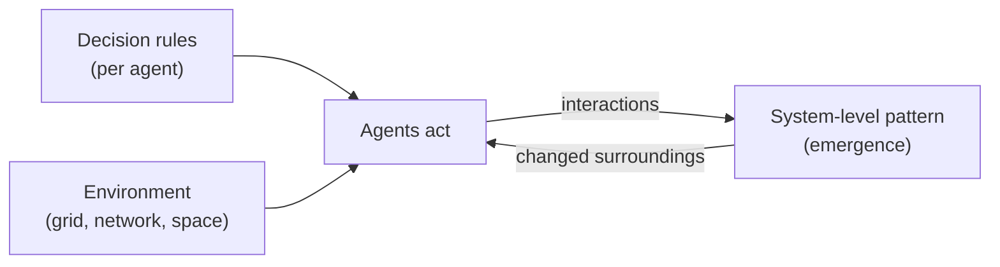

An agent-based model (ABM) simulates the actions and interactions of many autonomous **agents** to study how a system behaves as a whole. The central idea is **emergence**: simple rules at the level of individuals can produce complex, sometimes surprising patterns at the level of the group, and often the only way to see the pattern is to run the simulation. In ecology the same approach is called an individual-based model.

ABM is not tied to LLMs or to "agentic AI". It is a decades-old simulation method from the social and natural sciences, and the word "agent" there means something simpler (see the comparison below).

## Anatomy of an ABM



| Component | Role | Example |
| --------- | ---- | ------- |
| **Agents** | Autonomous individuals or groups, usually boundedly rational, following heuristics or simple rules; may learn or adapt | A household, a person, an animal, a firm |
| **Decision rules** | What an agent does given what it sees | "Move if too few neighbors are like me" |
| **Environment** | Where agents live and what they can perceive | A grid, a continuous space, a [[Centrality Measures]]-style network |
| **Interaction topology** | Who interacts with whom | Lattice neighborhoods or network edges |
| **Schedule** | The order in which agents act each step | Random order each step |

## Worked Example: Schelling's Segregation Model

Agents of two groups occupy cells of a grid, one per cell, and each looks at its eight neighbors. An agent wants at least a fraction of its neighbors to belong to its own group. If it falls below that, it moves to a vacant cell where it would be satisfied, and the process repeats.

The striking result: with equal-sized groups, a threshold of about **one third** is the tipping point. Below it the population settles into a mixed, random arrangement; at or above it the groups **segregate**. A mild preference for similar neighbors, with no intent to segregate, produces strongly segregated neighborhoods. The macro outcome is not obvious from the micro rule, which is what an ABM is built to reveal.

*Source: [Wikipedia, Schelling's model of segregation](https://en.wikipedia.org/wiki/Schelling%27s_model_of_segregation) (Schelling published it in 1971; the book Micromotives and Macrobehavior followed in 1978).*

## Other Classic Models and Uses

- **Conway's Game of Life:** simple cell rules on a grid yield complex behavior.
- **Axelrod's Prisoner's Dilemma tournament:** strategies compete and evolve.
- **Boids (flocking):** local steering rules produce flock motion.
- **Sugarscape (Epstein and Axtell):** large-scale social simulation of resources, trade, and inequality.
- **Applications:** epidemics and population dynamics, marketing and supply chains, traffic congestion, economics without assuming equilibrium, pedestrian flow and urban planning, and testing self-driving cars in simulated traffic.

*Source: [Wikipedia, Agent-based model](https://en.wikipedia.org/wiki/Agent-based_model).*

## Classic ABM vs. LLM Agent Systems

| | Classic ABM | LLM agent systems |
| --- | --- | --- |
| **Agent's decision-making** | Explicit rules or simple probabilities written by the modeler | A language model reads context and decides in free text |
| **Goal** | Understand how macro patterns emerge (a scientific model) | Get a task done (code, research, support) |
| **Scale** | Thousands to millions of cheap agents | A handful of expensive agents |
| **Reproducibility** | Controllable: same seed, same result | Stochastic and hard to reproduce |
| **Typical output** | Distributions and "what if we change this rule?" experiments | A finished artifact or action |

For LLM agent systems see [[Agents MOC]].

**Where they meet.** Since the 2020s researchers have used LLMs as the agents inside a simulation. In *Generative Agents* (Park et al., 2023), 25 LLM-driven characters lived in a sandbox town inspired by The Sims. Each agent stored experiences in natural language, synthesized them into higher-level reflections, and retrieved them to plan. From one user-specified intention (one agent wants to throw a Valentine's Day party) the agents spread invitations, made new acquaintances, and coordinated to arrive together. An ablation showed that observation, planning, and reflection each contributed to believability.

Costs of this approach: each agent step is an LLM call, so large populations are expensive; results are harder to reproduce and validate; and it is unclear whether emergent behavior reflects real people or the model's training data.

*Source: [Generative Agents: Interactive Simulacra of Human Behavior](https://arxiv.org/abs/2304.03442).*

## Validation and Criticism

- **Verification** checks that the code matches the conceptual model; **validation** checks the model against the real world (face validation, sensitivity analysis, calibration, statistical validation).
- Many frameworks were built for serial computers, which limits very large simulations.
- Critics note that ABMs can rest on simplistic assumptions, and that similar models can give very different results (a concern in economics and in epidemiology).
- The ODD protocol is a standard way to describe a model so others can reproduce it.

## Tooling: Mesa (Python)

[Mesa](https://mesa.readthedocs.io/latest/) is an Apache 2 licensed Python framework for ABM. It provides built-in modeling components (spatial grids, schedulers), flexible agent management through `AgentSet`, built-in data collection that works with Python's analysis tools, browser-based visualization with Solara, and an example model library. Mesa 3 is the stable release (`pip install -U mesa`, or `"mesa[rec]"` for recommended extras including network-modeling dependencies); Mesa 4 is in pre-release.

The official tutorial's first model is a **Boltzmann wealth model**: every agent starts with 1 unit of money and each step gives one unit to a random other agent. Despite equal starts and symmetric rules, wealth concentrates in a few agents, an emergent pattern.

```python
import mesa

class MoneyAgent(mesa.Agent):
    def __init__(self, model):
        super().__init__(model)
        self.wealth = 1

    def exchange(self):
        if self.wealth > 0:
            other_agent = self.random.choice(self.model.agents)
            if other_agent is not None:
                other_agent.wealth += 1
                self.wealth -= 1

class MoneyModel(mesa.Model):
    def __init__(self, n=10, rng=None):
        super().__init__(rng=rng)
        self.num_agents = n
        MoneyAgent.create_agents(model=self, n=n)

    def step(self):
        self.agents.shuffle_do("exchange")

model = MoneyModel(10)
for _ in range(30):
    model.step()
```

`shuffle_do` runs the agent method in random order each step (activation order can change results), and the `rng` argument fixes the seed for reproducible runs. For network-based models, build the graph with NetworkX (see [[Network Analysis Tools]]).

*Sources: [Mesa documentation](https://mesa.readthedocs.io/latest/) and its [first-model tutorial](https://mesa.readthedocs.io/latest/tutorials/0_first_model.html). The code is from the tutorial (Mesa 3); the API changed from earlier versions, so check the docs for your version.*

## Verification Status

The definitions, Schelling model, applications, validation points, Generative Agents summary, and the Mesa features and code were read on the sources linked above (the Wikipedia ABM page was read only in part, covering the first ~100,000 characters). I did not verify whether the community has built LLM integrations for Mesa. Please check the sources.

## Related Notes
- [[Agents MOC]] - LLM-based agents, a different sense of "agent".
- [[Network Analysis Tools]] - Building the networks agents can interact on.
- [[Centrality Measures]] - Identifying which agents or nodes drive spread in a network.
- [[Bipartite Networks]] - Another structure agents can interact on (e.g. users and items).
