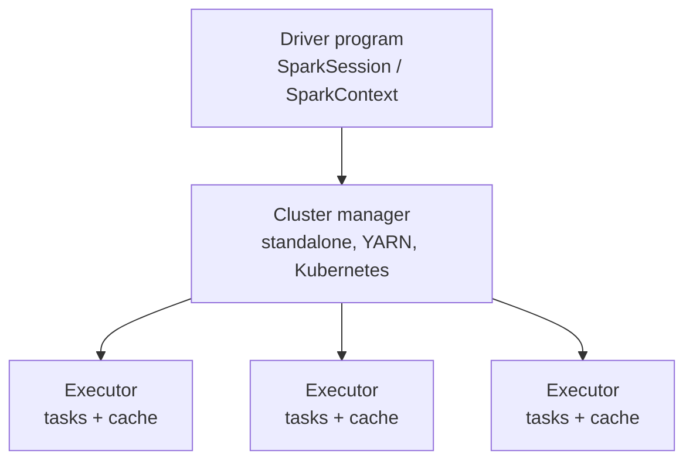

**Apache Spark** is an open-source distributed computing engine for fast, general-purpose data processing. Its key idea is keeping intermediate data **in memory** across a cluster instead of writing it to disk after every step, as [[Hadoop and MapReduce]] does. One engine covers batch jobs, SQL, streaming, machine learning, and graph analytics, with APIs in Python, Scala, Java, and R. Spark's documentation cites speedups of up to roughly 100x over MapReduce for in-memory workloads, with the biggest gains on iterative algorithms such as ML training. *Source: [Apache Spark overview](https://spark.apache.org/docs/latest/).*

## Architecture



The **driver** builds a plan, a **cluster manager** allocates resources, and **executors** run tasks on partitions of the data.

## Core Components

| Component | What it provides |
| :-- | :-- |
| RDDs (Resilient Distributed Datasets) | The low-level, immutable, partitioned collection that supports parallel operations |
| DataFrames and Datasets | Table-like, schema-aware abstractions optimized by the Catalyst query optimizer |
| Spark SQL | SQL queries over structured and semi-structured data |
| Spark Streaming / Structured Streaming | Continuous processing of live data ([[Stream Processing and Event Streaming]]) |
| MLlib | Scalable machine learning ([[Distributed Machine Learning and Graph Processing]]) |
| GraphX | Graph-parallel computation |

## RDDs and Lazy Evaluation
An RDD is an immutable collection split into **partitions** spread across nodes. Two kinds of operations act on it:

- **Transformations** (`map`, `filter`, `reduceByKey`, `join`) build a new RDD lazily. Nothing runs yet.
- **Actions** (`count`, `collect`, `saveAsTextFile`) trigger execution of the whole plan.

Laziness lets Spark see the full chain, pipeline narrow steps together, and only shuffle data when a **wide** transformation (like `reduceByKey`) requires it.

**Fault tolerance via lineage.** Instead of replicating data, each RDD remembers the chain of transformations that produced it (its **lineage**). If a partition is lost, Spark recomputes just that partition from its parents.

## Example: PySpark
```python
from pyspark.sql import SparkSession

spark = SparkSession.builder.appName("Example").getOrCreate()
df = spark.read.csv("data.csv", header=True, inferSchema=True)
df.show()

# Same engine, SQL style
df.createOrReplaceTempView("events")
spark.sql("SELECT category, COUNT(*) AS n FROM events GROUP BY category").show()
```

Word count, the classic MapReduce example, is three lines of RDD code:
```python
counts = (sc.textFile("hdfs:///books/*.txt")
            .flatMap(lambda line: line.split())
            .map(lambda w: (w, 1))
            .reduceByKey(lambda a, b: a + b))
```

## Spark vs. Hadoop MapReduce

| Aspect | MapReduce | Spark |
| :-- | :-- | :-- |
| Intermediate data | Written to disk | Kept in memory when possible |
| Speed | Slower, disk-bound | Much faster on iterative and interactive work |
| Programming model | Rigid map then reduce | Rich operators, SQL, DataFrames |
| Real-time | Batch only | Micro-batch and continuous streaming |
| Fault recovery | Re-run failed tasks | Recompute from lineage |
| Storage | HDFS | Reads HDFS, S3, Cassandra, Kafka, and more |

Spark does not replace storage: it commonly runs on top of HDFS or object storage.

## Typical Use Cases
- **Real-time analytics** on IoT, financial, or social streams.
- **Machine learning** for recommendation, anomaly detection, and prediction.
- **ETL** over large structured and unstructured sources.
- **Interactive exploration** of big tables through SQL or notebooks.

## Related
[[Big Data Fundamentals and Architecture]] places Spark in the processing layer; [[Big Data Integration and Orchestration]] covers how jobs are scheduled. For Python-native ML, tuning, and serving workloads, see [[Ray]].
