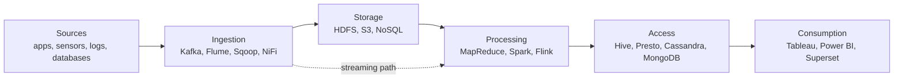

**Big data** describes datasets that are too large, too fast, or too messy for a single machine or a traditional database to store and process. The defining move is architectural: instead of buying a bigger server (vertical scaling), spread data and computation across many cheap machines (horizontal scaling). Every tool in this section, from [[Hadoop and MapReduce]] to [[Apache Spark]], is a way of making that spreading practical.

## The Four Vs

| V | Meaning | Typical pressure it creates | Tools that address it |
| :-- | :-- | :-- | :-- |
| Volume | Sheer scale: terabytes to petabytes from sensors, logs, transactions, social media | Storage that grows by adding nodes | HDFS, Amazon S3, object storage |
| Velocity | Rate at which data arrives and must be handled | Low-latency ingestion and processing | Kafka, Flink, Spark Streaming ([[Stream Processing and Event Streaming]]) |
| Variety | Structured (tables), semi-structured (JSON, XML), unstructured (text, images, video) | Flexible schemas and formats | NoSQL stores, data lakes ([[Database Types]]) |
| Veracity | Trustworthiness: noise, gaps, duplicates, bias | Cleaning and validation before analysis | ETL pipelines, data quality checks |

Some authors add a fifth V, **Value**: data only matters if analysis turns it into decisions.

## Core Challenges
- **Storage:** keep petabytes durable and available, with redundancy so one disk failure loses nothing.
- **Processing:** a single-machine program cannot scan that much data in reasonable time, so work must be split across a cluster.
- **Analysis:** extracting patterns from huge, fast, heterogeneous data calls for scalable ML ([[Distributed Machine Learning and Graph Processing]]).
- **Data quality:** large datasets accumulate noise, anomalies, and sampling bias.
- **Security and privacy:** sensitive data raises access-control, encryption, and regulatory duties (GDPR, HIPAA, CCPA).

## Layered Reference Architecture

| Layer | Job | Example tools |
| :-- | :-- | :-- |
| Ingestion | Capture batch and streaming data from sources | Kafka, Flume, Sqoop, NiFi ([[Big Data Integration and Orchestration]]) |
| Storage | Hold data durably across many nodes | HDFS, Amazon S3, Google Cloud Storage |
| Processing | Transform and analyze at scale | MapReduce, Spark, Flink |
| Access | Let users and apps query results | SQL engines (Hive, Presto), NoSQL stores |
| Consumption | Dashboards and BI | Tableau, Power BI, Apache Superset |

Two well-known patterns combine the batch and streaming paths. The **Lambda architecture** runs a batch layer (accurate, slow) alongside a speed layer (approximate, fast) and merges their views. The **Kappa architecture** simplifies this by treating everything as a stream and reprocessing the log when logic changes.

## Storage Options

| Option | How it stores data | Strengths | Examples |
| :-- | :-- | :-- | :-- |
| Distributed file system | Large files split into blocks replicated across nodes | High-throughput sequential reads, fault tolerance | HDFS |
| Object storage | Flat namespace of objects plus metadata | Cheap, near-unlimited scale, ideal for media and data lakes | Amazon S3, MinIO, Google Cloud Storage |
| Block storage | Fixed-size blocks behind a volume | Low latency for databases and VMs | Amazon EBS, Azure Managed Disks |
| Hybrid | On-premises plus cloud | Balances control, cost, and elasticity | Mixed deployments |
| NoSQL databases | Key-value, document, column-family, or graph models | Low-latency reads and writes at scale | Redis, MongoDB, Cassandra, Neo4j |

A **data lake** keeps raw data in cheap object or distributed storage and applies structure when it is read (schema-on-read). A **data warehouse** stores cleaned, modelled data for fast SQL analytics (schema-on-write).

## Distributed Computing in One Page
A **distributed system** is a set of networked machines (nodes) cooperating on one task. Four principles recur:

1. **Scalability:** add nodes to handle more work.
2. **Fault tolerance:** keep running when nodes fail, typically via replication and by re-running lost tasks.
3. **Consistency:** keep copies of data in agreement across nodes.
4. **Concurrency control:** coordinate simultaneous access to shared resources.

### CAP theorem
Under a network **partition** a distributed store must choose between **consistency** (every read sees the latest write) and **availability** (every request gets a response). Since partitions cannot be ruled out in practice, systems are often described as CP or AP. Roughly, MongoDB leans consistent and Cassandra leans available. Details and the ACID vs BASE contrast live in [[Database Selection]].

### Standing trade-offs
- **Performance vs. complexity:** parallel systems are fast but need careful coordination.
- **Fault tolerance vs. consistency:** strong consistency across replicas costs latency and availability.
- **Latency vs. throughput:** tuning for fast individual responses usually lowers total work per second, and the reverse.

## Where Big Data Is Used

| Sector | Typical applications |
| :-- | :-- |
| Healthcare | Outbreak prediction, genomics-driven personalized medicine, hospital staffing |
| Finance | Fraud and anomaly detection, risk scoring, high-frequency trading |
| Retail | Demand forecasting, recommendations, basket analysis |
| Telecommunications | Network traffic analysis, churn prediction |
| Manufacturing | Predictive maintenance from sensor data, defect detection |
| Energy | Smart-grid balancing, renewable generation forecasting |
| Public sector | Traffic and urban planning from IoT feeds, disaster response |

## Responsible Use
Large-scale collection raises ethical duties: obtain informed **consent**, explain how data is used (**transparency**), audit models for **bias**, and practice **data minimization** (collect only what is needed) plus secure deletion or anonymization at end of life. Regulations such as the EU **GDPR** (explicit consent, right to be forgotten), California's **CCPA**, the U.S. **HIPAA** for health data, and Sarbanes-Oxley for financial reporting make some of these duties legally binding. Common safeguards are encryption, role-based access control, breach-response plans, and network segmentation.
