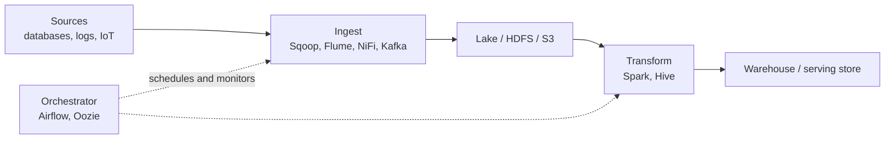

Two chores glue a big data stack together. **Integration** combines data from many sources into a unified, consistent view (data lakes, ETL/ELT pipelines, analytics inputs). **Orchestration** automates, sequences, schedules, and monitors the jobs that move and transform that data so each step runs in the right order and failures are visible. The tools below split along that line, and each fits a layer of the architecture in [[Big Data Fundamentals and Architecture]].

**ETL** (Extract, Transform, Load) cleans data before loading it into a warehouse. **ELT** loads raw data first and transforms it inside the destination, which suits cheap lake storage and powerful engines such as [[Apache Spark]].



## Tools

| Tool | Category | What it does | Typical use |
| :-- | :-- | :-- | :-- |
| Apache NiFi | Integration, ingestion | Visual drag-and-drop flow design for routing, transforming, and mediating data between systems, with built-in back-pressure and provenance tracking | Stream sensor data from IoT devices to a cloud analytics system |
| Apache Kafka | Integration, streaming | Distributed event log connecting producers and consumers ([[Stream Processing and Event Streaming]]) | Stream website clickstream data to an analytics engine |
| Apache Flume | Ingestion | Distributed service that collects, aggregates, and ships large volumes of log data, mainly into HDFS or cloud storage | Collect logs from many web servers in near real time |
| Apache Sqoop | Ingestion | Bulk transfer between relational databases and Hadoop | Import a SQL table into HDFS (now retired, but still seen in legacy stacks) |
| Apache Airflow | Orchestration | Define workflows as Python code using **DAGs** (directed acyclic graphs) of tasks with dependencies, schedules, retries, and a monitoring UI | Daily pipeline that extracts, transforms, and loads transactions into a warehouse |
| Apache Oozie | Orchestration | Workflow scheduler for Hadoop jobs (MapReduce, Spark, Hive, Pig) | Periodic batch jobs on a Hadoop cluster ([[Hadoop and MapReduce]]) |

## Airflow in a Few Lines
A DAG declares what runs and in what order; Airflow handles scheduling, retries, and backfills.

```python
from airflow import DAG
from airflow.operators.python import PythonOperator
from datetime import datetime

with DAG("daily_sales", start_date=datetime(2026, 1, 1), schedule="@daily") as dag:
    extract   = PythonOperator(task_id="extract",   python_callable=extract_fn)
    transform = PythonOperator(task_id="transform", python_callable=transform_fn)
    load      = PythonOperator(task_id="load",      python_callable=load_fn)
    extract >> transform >> load
```
*Source: [Apache Airflow documentation](https://airflow.apache.org/docs/).*

## Which One to Pick

| Question | Answer |
| :-- | :-- |
| Move and transform data in real time with a GUI? | NiFi |
| Stream events between many systems with replay? | Kafka |
| Collect log files into storage? | Flume |
| Schedule complex multi-step batch workflows? | Airflow |
| Schedule jobs inside a Hadoop-only shop? | Oozie |

Integration tools move bytes; orchestrators decide when and in what order. Production stacks usually combine one of each, for example NiFi or Kafka for ingestion and Airflow to schedule the Spark jobs that follow.
