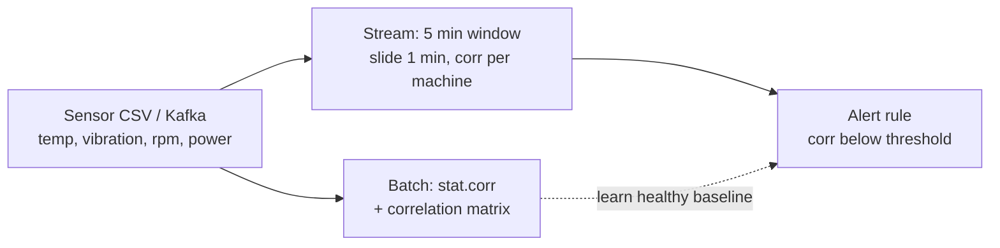

A worked pattern for predictive maintenance: compute correlations between machine sensors in batch with [[Apache Spark]], then watch them over sliding windows with Structured Streaming and alert when a relationship that normally holds starts to break. The statistics come from [[Correlation Coefficients]]; the streaming ideas from [[Stream Processing and Event Streaming]].



## Setup and Data
```bash
python -m venv venv && source venv/bin/activate
pip install pyspark==3.5.1 pandas
```

One reading per minute per machine:

```csv
timestamp,machine_id,temp_c,vibration_mm_s,rpm,power_kw
2025-10-01T09:00:00,MX01,62.1,3.8,1450,12.2
2025-10-01T09:01:00,MX01,62.4,3.9,1455,12.3
2025-10-01T09:02:00,MX01,62.7,4.0,1457,12.4
2025-10-01T09:03:00,MX01,63.0,4.2,1460,12.6
2025-10-01T09:04:00,MX01,63.2,4.4,1462,12.8
```

## Batch: Pairwise and Matrix Correlation
```python
from pyspark.sql import SparkSession
from pyspark.ml.feature import VectorAssembler
from pyspark.ml.stat import Correlation

spark = SparkSession.builder.appName("BatchCorrelation").getOrCreate()
df = (spark.read.option("header", True).option("inferSchema", True)
      .csv("data/sensors_batch.csv"))

num_cols = ["temp_c", "vibration_mm_s", "rpm", "power_kw"]
df_num = df.select(*num_cols).na.drop()

# Pairwise Pearson (quick)
for a, b in [("temp_c", "vibration_mm_s"), ("temp_c", "power_kw"), ("rpm", "power_kw")]:
    print(f"corr({a}, {b}) = {df_num.stat.corr(a, b):.4f}")

# Full correlation matrix
vec = VectorAssembler(inputCols=num_cols, outputCol="features").transform(df_num)
print(Correlation.corr(vec, "features", "pearson").head()[0])
```

- `DataFrame.stat.corr` returns one Pearson coefficient for a pair of columns.
- `Correlation.corr` over an assembled vector column returns the whole matrix, and accepts `"spearman"` as well as `"pearson"`.

On the five rows above: temperature vs. vibration $r = 0.973$, temperature vs. power $0.973$, rpm vs. power $0.949$. Strong positive coupling like this is normal in a healthy machine: more load raises power, heat, and vibration together.

## Streaming: Sliding-Window Correlation
```python
from pyspark.sql import SparkSession
from pyspark.sql.functions import col, window, corr, to_timestamp, when

spark = SparkSession.builder.appName("StreamingCorrelation").getOrCreate()
schema = ("timestamp STRING, machine_id STRING, temp_c DOUBLE, "
          "vibration_mm_s DOUBLE, rpm DOUBLE, power_kw DOUBLE")

stream_df = (spark.readStream.option("header", True).schema(schema)
             .csv("data/stream_in"))                 # watches a folder

clean = (stream_df.withColumn("ts", to_timestamp("timestamp"))
         .dropna(subset=["temp_c", "vibration_mm_s", "ts"]))

win_corr = (clean
    .groupBy(window(col("ts"), "5 minutes", "1 minute"), col("machine_id"))
    .agg(corr("temp_c", "vibration_mm_s").alias("corr_tv"))
    .orderBy("window"))

alerts = win_corr.withColumn(
    "alert", when(col("corr_tv") < 0.5, "LOW_CORRELATION").otherwise("OK"))

(alerts.writeStream.outputMode("complete").format("console")
    .option("truncate", False)
    .option("checkpointLocation", "data/stream_checkpoint")
    .start().awaitTermination())
```

Drop `part1.csv` (four healthy rows) into `data/stream_in`, watch `alert = OK`, then drop `part2.csv`, where temperature keeps rising but vibration falls (3.2, 3.1, 3.0). Mean levels barely change; only the **relationship** does, which is what the correlation catches. Possible causes: loosened mounts, lubrication problems, or sensor drift.

### What the windows actually show
Window of 5 minutes sliding every minute over the seven rows (computed offline with NumPy on the same values):

| Window starts at | Rows in window | Temp-vibration correlation |
| :-- | :-- | :-- |
| 09:-3 | 2 | 1.000 |
| 09:-1 | 4 | 0.947 |
| 09:00 | 5 | -0.351 |
| 09:01 | 5 | -0.772 |
| 09:02 | 5 | -0.922 |
| 09:05 | 2 | -1.000 |

The healthy windows sit near 1, then the correlation falls through zero and turns strongly negative as degraded points enter the window.

## Pitfalls in the Example
- **Tiny windows are noise:** with 2 points a correlation is always exactly $\pm 1$, and with 3 or 4 it is highly unstable. Real monitoring needs a minimum row count per window before alerting.
- **Single-row windows give null:** `when(null < 0.5)` is not true, so the row falls into `otherwise("OK")` and the alert silently does not fire. Handle nulls explicitly.
- **Threshold, not drift:** `corr < 0.5` is a fixed cutoff. Detecting a *drop* relative to a baseline needs stateful comparison (for example, a baseline window per machine).
- **Shared trend:** temperature and vibration both rising with time inflates the correlation. Detrend or difference the series before judging coupling.
- **`complete` output mode** keeps every window in state indefinitely. For long-running jobs use `append` or `update` with a watermark.
- **Per-machine baselines:** grouping by `machine_id` is right, since healthy correlations differ between machines and operating regimes.

## Discussion Points
- **Signs and magnitudes:** positive means the signals rise together; values near $\pm1$ are tight coupling.
- **Corr near 0 is not independence:** a nonlinear dependence can give $r\approx 0$. See the callout in [[Correlation Coefficients]].

## Kafka Variant
Only the source changes; the windowed `corr` logic is identical:

```python
stream_df = (spark.readStream.format("kafka")
    .option("kafka.bootstrap.servers", "localhost:9092")
    .option("subscribe", "sensors").load())

from pyspark.sql.functions import from_csv
parsed = (stream_df.select(from_csv(col("value").cast("string"), schema).alias("r"))
          .select("r.*"))
```

*Sources: [Spark Structured Streaming guide](https://spark.apache.org/docs/latest/structured-streaming-programming-guide.html), [Spark ML statistics](https://spark.apache.org/docs/latest/ml-statistics.html). Spark was not installed locally, so the code was not executed; window values were verified with an equivalent NumPy computation.*
