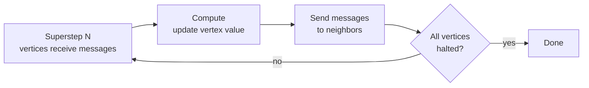

Once data no longer fits on one machine, training models and traversing relationships must be distributed too. Big data analytics frameworks provide scalable versions of familiar algorithms (classification, clustering, recommendation) and of **graph processing**, the analysis of entities (nodes) and their relationships (edges). For the engines underneath, see [[Apache Spark]] and [[Hadoop and MapReduce]].

## Machine Learning at Scale
Distributed ML spreads data across a cluster so each node computes partial results (for example gradients or cluster sums) that are combined. It powers predictive analytics, recommendation, fraud and anomaly detection, and customer segmentation.

| Library | Built on | Highlights |
| :-- | :-- | :-- |
| Apache Mahout | Hadoop MapReduce, later Spark | Clustering (k-means), classification (Naive Bayes), collaborative filtering; largely overtaken by MLlib in practice |
| Spark MLlib | Apache Spark | Classification, regression, clustering, recommendation (ALS), dimensionality reduction, pipelines; in-memory iteration makes training much faster than disk-based MapReduce |

*Source: [Spark MLlib guide](https://spark.apache.org/docs/latest/ml-guide.html).*

### MLlib example: logistic regression
```python
from pyspark.sql import SparkSession
from pyspark.ml.classification import LogisticRegression

spark = SparkSession.builder.appName("ML Example").getOrCreate()
data = spark.read.format("libsvm").load("sample_libsvm_data.txt")

lr = LogisticRegression(maxIter=10)
model = lr.fit(data)
model.summary.predictions.show()
```
For deep learning, hyperparameter search, and RL on a cluster, see [[Ray]] (Ray Train, Tune, RLlib). MLlib's `Pipeline` chains feature transformers and an estimator so the same steps run identically in training and inference. For model background see [[Machine Learning MOC]].

### Common ML use cases
- **Fraud detection:** flag anomalous transactions.
- **Healthcare analytics:** find disease patterns and predict outcomes.
- **Customer segmentation:** cluster buyers by behavior.
- **Search relevance:** learn ranking signals.

## Graph Processing
Graph data models highly connected domains: social networks, financial transactions, supply chains, protein interactions. Two different tool families exist.

| Kind | Tools | Role |
| :-- | :-- | :-- |
| Graph **databases** (store and query) | Neo4j, Amazon Neptune, ArangoDB | Native graph storage with fast relationship traversal ([[Database Types]]) |
| Graph **computation frameworks** (analyze at scale) | Apache Giraph, Spark GraphX | Iterative algorithms over graphs too large for one machine |

### Neo4j
A native graph database queried with **Cypher**, a declarative pattern-matching language.
```cypher
// Accounts that share a phone number with a flagged account
MATCH (flagged:Account {status: "flagged"})-[:HAS_PHONE]->(p:Phone)<-[:HAS_PHONE]-(other:Account)
RETURN other.id, p.number
```
Typical uses: fraud rings, recommendation engines, knowledge graphs. *Source: [Neo4j Cypher manual](https://neo4j.com/docs/cypher-manual/current/).*

### Apache Giraph
Distributed graph processing on Hadoop using the **Pregel** model: computation is **vertex-centric** and proceeds in **supersteps**. In each superstep every vertex reads messages, updates its value, and sends messages to neighbors, until all vertices vote to halt. PageRank is the canonical example.



### Spark GraphX
A graph library inside Spark that supports graph-parallel computation (PageRank, connected components, triangle counting) alongside DataFrames, SQL, and MLlib in one program. *Source: [GraphX programming guide](https://spark.apache.org/docs/latest/graphx-programming-guide.html).*

### Graph use cases
1. **Social network analysis:** influencers and communities.
2. **Recommendation:** products or friends from connection patterns.
3. **Fraud detection:** hidden relationships between accounts.
4. **Biological networks:** protein-protein interactions and disease links.

## Choosing
Use a graph **database** when you need low-latency queries over live relationship data. Use a graph **framework** (GraphX, Giraph) for offline, whole-graph analytics. Pair either with the pipelines in [[Big Data Integration and Orchestration]] to keep the graph fed.
