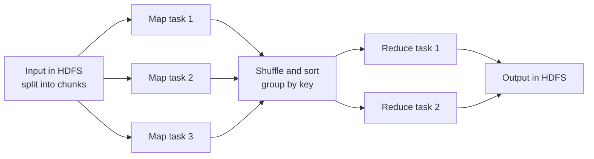
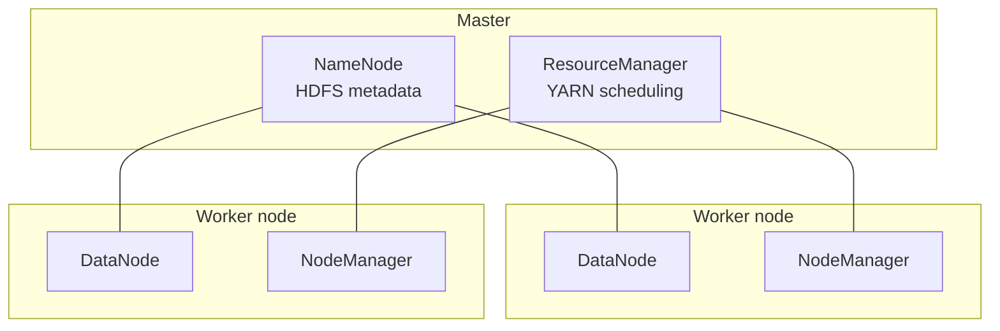

**Apache Hadoop** is an open-source framework for storing and processing very large datasets on clusters of commodity hardware. It bundles three pieces: **HDFS** for storage, **YARN** for resource management, and **MapReduce** for computation. Its guiding bet is that moving code to the data beats moving data to the code, and that failures are normal at scale, so software must tolerate them. For the faster in-memory successor, see [[Apache Spark]]; for the surrounding system design, see [[Big Data Fundamentals and Architecture]].

## MapReduce
**MapReduce** is a programming model that expresses a computation as two user-written functions over key-value pairs. The framework handles splitting, scheduling, data movement, and failure recovery.



1. **Input splitting:** the input is divided into chunks spread over nodes.
2. **Map:** each mapper turns records into intermediate `(key, value)` pairs.
3. **Shuffle and sort:** the framework moves all values for the same key to one reducer, sorted by key.
4. **Reduce:** each reducer aggregates the values for its keys.
5. **Output:** results are written back to HDFS or another store.

### Example: word count
```python
# Conceptual pseudocode (Hadoop Streaming style)
def mapper(line):
    for word in line.split():
        emit(word, 1)          # ("hello", 1)

def reducer(word, counts):
    emit(word, sum(counts))    # ("hello", 42)
```
Because each mapper sees only its own chunk and each reducer sees only one key's values, thousands of tasks run in parallel with no shared state. An optional **combiner** pre-aggregates on the mapper side to shrink shuffle traffic.

| Strengths | Limitations |
| :-- | :-- |
| Scales to petabytes across many machines | High latency, so batch only |
| Re-runs failed tasks automatically | Verbose custom Java or Python code per job |
| Independent tasks parallelize cleanly | Intermediate results are written to disk, so heavy disk I/O |

## Hadoop Architecture
Hadoop uses a **master-worker** layout.



### HDFS (Hadoop Distributed File System)
Splits each file into large **blocks** (128 MB by default, often raised to 256 MB) and stores each block on several DataNodes (replication factor 3 by default). The **NameNode** keeps the directory tree and block locations; **DataNodes** hold the bytes. HDFS favours huge sequential reads over low-latency random access, and files are essentially write-once. *Source: [HDFS Architecture](https://hadoop.apache.org/docs/stable/hadoop-project-dist/hadoop-hdfs/HdfsDesign.html).*

### YARN (Yet Another Resource Negotiator)
Separates **resource management** (the ResourceManager allocates CPU and memory in containers, NodeManagers run them) from **application logic**. This is why Spark, Flink, and other engines can share a Hadoop cluster with MapReduce.

## Ecosystem

| Tool | Role |
| :-- | :-- |
| Hive | SQL-like queries (HiveQL) compiled to distributed jobs over structured data |
| Pig | High-level dataflow scripting (Pig Latin) for transformations |
| HBase | Column-family NoSQL store with real-time reads and writes on HDFS (see [[Database Types]]) |
| Oozie | Workflow scheduler for Hadoop jobs ([[Big Data Integration and Orchestration]]) |
| Sqoop, Flume | Ingestion from relational databases and log streams |
| Mahout | Scalable ML library ([[Distributed Machine Learning and Graph Processing]]) |

## Pros and Cons

| Advantages | Limitations |
| :-- | :-- |
| Scale out by adding nodes | Batch-oriented, high latency |
| Replication keeps data available through node failure | Operationally complex to install, tune, and manage |
| Cheap commodity hardware | Disk-heavy processing is slower than in-memory engines |
| Handles structured, semi-structured, and unstructured data | Poor fit for iterative algorithms and interactive queries |

Today many teams keep HDFS or cloud object storage and YARN or Kubernetes for resources, but run Spark or Flink instead of classic MapReduce for the compute step.
