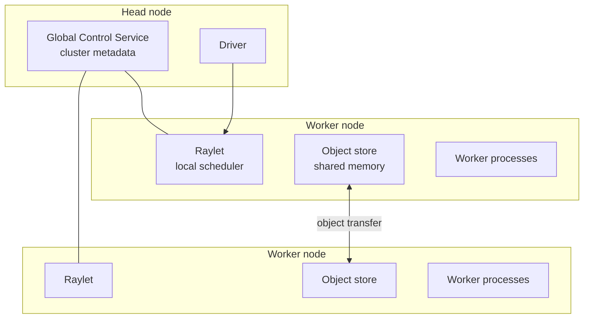

**Ray** is an open-source framework for scaling Python and AI workloads from a laptop to a cluster. It began at UC Berkeley's RISELab and is developed today by Anyscale and the open-source community. Where [[Hadoop and MapReduce]] and [[Apache Spark]] centre on data-parallel batch analytics, Ray is a general-purpose **task and actor runtime**: you turn ordinary Python functions and classes into distributed ones, which suits ML training, hyperparameter search, reinforcement learning, and model serving. *Source: [Ray documentation](https://docs.ray.io/en/latest/).*

## Core Primitives

| Primitive | What it is | Use |
| :-- | :-- | :-- |
| Task | A stateless function decorated with `@ray.remote`, run asynchronously on any worker | Embarrassingly parallel work, fan-out/fan-in |
| Actor | A stateful class instance living on one worker, called remotely | Parameter servers, simulators, model replicas, counters |
| Object | An immutable value in the distributed **object store**, referenced by an `ObjectRef` (future) | Passing data between tasks without copying through the driver |

```python
import ray
ray.init()

@ray.remote
def square(x):
    return x * x

@ray.remote
class Counter:
    def __init__(self): self.n = 0
    def inc(self):
        self.n += 1
        return self.n

futures = [square.remote(i) for i in range(8)]   # returns immediately
print(ray.get(futures))                          # blocks, collects results

c = Counter.remote()
ray.get([c.inc.remote() for _ in range(3)])      # [1, 2, 3]
```

Calls return **futures** immediately, so the program builds a dynamic task graph at runtime. This is more flexible than Spark's mostly static, lazily planned DAG, and lets tasks launch other tasks.

## Architecture



- Each node runs a **raylet** that schedules tasks locally and spills to other nodes when busy.
- Each node has a shared-memory **object store**, so workers on one machine read the same data without copies (zero-copy for NumPy arrays).
- The **GCS** on the head node tracks nodes, actors, and resources.
- Tasks declare resources, for example `@ray.remote(num_gpus=1)`, which makes GPU and heterogeneous scheduling first-class.

**Fault tolerance:** failed tasks are retried, lost objects can be reconstructed from lineage, and actors can be restarted (state must be restored by the user, for example from checkpoints).

## Ray AI Libraries

| Library | Purpose |
| :-- | :-- |
| Ray Data | Scalable data loading and preprocessing for ML, streaming batches to training or inference |
| Ray Train | Distributed training wrappers for PyTorch, TensorFlow, XGBoost, and others |
| Ray Tune | Hyperparameter search with schedulers such as ASHA and population-based training |
| Ray Serve | Online model serving with autoscaling and model composition |
| RLlib | Distributed reinforcement learning algorithms |

Ray Train and RLlib are the Ray counterparts to [[Distributed Machine Learning and Graph Processing]]'s Spark MLlib, aimed at deep learning and RL rather than classical algorithms.

## Ray vs. Spark

| Aspect | Spark | Ray |
| :-- | :-- | :-- |
| Core model | Partitioned datasets (RDD, DataFrame) with SQL optimizer | Tasks, actors, and shared objects |
| Best at | Large-scale ETL, SQL, batch and micro-batch analytics | ML training and tuning, RL, serving, simulation, mixed CPU/GPU pipelines |
| Language focus | JVM first, Python via PySpark | Python first |
| State | Mostly stateless transformations | Native stateful actors |
| Scheduling | Stage-based, planned from the DAG | Fine-grained, dynamic, millisecond-scale tasks |
| Streaming | Structured Streaming | Not a streaming engine; Ray Data streams batches into ML jobs |

They are complementary: a common pattern uses Spark for heavy ETL, then Ray for training and serving. Ray is not a storage system or a message queue, so it still sits on top of the layers in [[Big Data Fundamentals and Architecture]] (object storage for data, [[Stream Processing and Event Streaming]] tools for live feeds).

## Deployment
Run locally with `ray.init()`, on a cluster started with `ray up` or the Ray cluster launcher, on Kubernetes with **KubeRay**, or as a managed service (Anyscale). The Ray Dashboard shows tasks, actors, and resource use.
