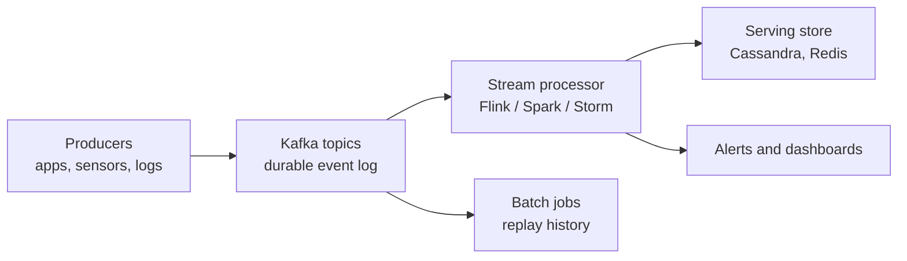

**Stream processing** handles data continuously as it arrives, event by event, instead of waiting to collect a batch. It answers questions such as "is this card transaction fraudulent?" in milliseconds rather than the next morning. A streaming stack usually has two parts: an **event log** that durably buffers events (Kafka, Kinesis) and a **stream processor** that computes over them (Flink, Spark, Storm).

## Batch vs. Stream

| Aspect | Batch | Stream |
| :-- | :-- | :-- |
| Model | Collect, store, then process fixed chunks on a schedule | Process each event as generated |
| Latency | High: results after the job finishes | Low: milliseconds to seconds |
| Typical use | Daily reports, historical analysis, large ETL | Fraud detection, live monitoring, trading |
| Complexity | Simpler to build and optimize | Needs event-driven design, state, and checkpointing |
| Failure recovery | Reprocess the whole batch | Restore state from checkpoints |
| Resources | Burst compute during runs | Always-on resources |
| Example tools | Hadoop MapReduce, Spark batch, BigQuery | Kafka, Flink, Spark Streaming |

## Concepts That Matter
- **Event time vs. processing time:** when something happened versus when the system saw it. Late and out-of-order events make this distinction essential.
- **Windows:** finite slices of an unbounded stream for aggregation: **tumbling** (fixed, non-overlapping), **sliding** (overlapping), and **session** (gap-based).
- **State and checkpointing:** operators remember running totals; periodic snapshots allow recovery after a crash.
- **Delivery semantics:** at-most-once, at-least-once, or **exactly-once** processing. Exactly-once is the hardest and most valuable.

## Tools

### Apache Kafka
A distributed **event streaming platform** for high-throughput, fault-tolerant pipelines.
- **Producers** publish records to **topics**.
- **Brokers** store and serve records; each topic is split into **partitions** that are replicated for durability.
- **Consumers** subscribe to topics, and **consumer groups** divide partitions among members for parallel reads.
- Records are retained on disk for a configurable time, so consumers can **replay** history.

Kafka is the usual backbone for event-driven architectures and for feeding other engines. *Source: [Apache Kafka documentation](https://kafka.apache.org/documentation/).*

### Apache Storm
A real-time computation system for unbounded streams with very low latency, scaling horizontally. A **topology** wires **spouts** (data sources) to **bolts** (processing steps). Pioneering, but largely displaced by Flink for new work.

### Apache Flink
A stream-first processor that also runs batch as a special case. Highlights: **event-time processing**, **stateful** computation, **windowing**, and **exactly-once** state consistency through distributed snapshots. It also offers libraries for ML and graph work. *Source: [Apache Flink documentation](https://nightlies.apache.org/flink/flink-docs-stable/).*

### Spark Streaming
A **micro-batch** extension of [[Apache Spark]]: the stream is cut into small batches processed by the Spark engine. It inherits in-memory speed, MLlib integration, and lineage-based recovery. Latency is typically seconds rather than milliseconds. The newer **Structured Streaming** API treats a stream as an ever-growing table queried with DataFrame or SQL code.

### Managed cloud services

| Service | Provider | Notes |
| :-- | :-- | :-- |
| Amazon Kinesis | AWS | Data Streams (storage and processing), Firehose (load to S3 and Redshift), analytics with SQL |
| Cloud Dataflow | Google Cloud | Managed Apache Beam runner with autoscaling and dynamic work rebalancing |
| Stream Analytics | Microsoft Azure | SQL-based queries; integrates with IoT Hub and Event Hubs |

## Choosing a Tool

| Need | Good fit |
| :-- | :-- |
| Durable, replayable event backbone | Kafka |
| Lowest latency, rich state, event-time semantics | Flink |
| One engine for batch, ML, and near-real-time | Spark Streaming |
| Fully managed, no cluster to run | Kinesis, Dataflow, Stream Analytics |

## Applications
- **Log analysis:** detect attacks and failures from firewall and server logs.
- **Fraud detection:** score each card transaction against spending patterns, for example Kafka plus Spark Streaming.
- **Real-time advertising:** bid on ad slots within milliseconds using live behavior.
- **IoT monitoring:** predictive maintenance and smart-grid balancing.
- **Healthcare:** continuous patient-vitals monitoring with instant alerts.
- **Trading:** automated decisions on market ticks.
- **Smart traffic:** adjust signals from camera and GPS data.

## Trade-offs
Stream processing gives low latency, scalability, and fault tolerance, but it is more complex, needs always-on infrastructure, and must cope with noisy or incomplete live data. Pair it with batch for reprocessing, as in the Lambda and Kappa patterns described in [[Big Data Fundamentals and Architecture]]. Sinks are often NoSQL stores; see [[Database Types]].
