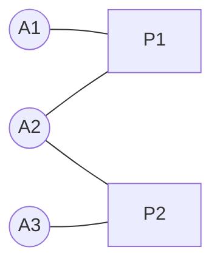

A **bipartite network** (two-mode network) has two disjoint sets of nodes, and every edge connects a node in one set to a node in the other. Nothing links two nodes of the same type. They model "who belongs to what" relationships.

| Set 1 | Set 2 | Edge means |
| ----- | ----- | ---------- |
| Authors | Papers | wrote |
| Users | Products | purchased or rated |
| Actors | Movies | appeared in |
| Plants | Pollinators | is visited by |
| Genes | Diseases | is associated with |

## Definition and Test

A graph is bipartite exactly when its nodes can be **two-colored** so that no edge joins nodes of the same color. Equivalently, it contains **no odd-length cycle**. A breadth-first search that alternates colors tests this in linear time. Note that a connected graph has a unique bipartition, but a disconnected one does not, so the two sets are usually stored explicitly.

## Running Example

Four authors-and-papers edges: A1 and A2 wrote P1; A2 and A3 wrote P2.



The **biadjacency matrix** $B$ has one row per author and one column per paper:

$$B = \begin{pmatrix} 1 & 0 \\ 1 & 1 \\ 0 & 1 \end{pmatrix}$$

Because only cross-set edges exist, the full adjacency matrix is block-structured and $B$ carries all the information.

## One-Mode Projections

A projection collapses the network onto a single node type. Two nodes in the same set are connected if they share at least one neighbor in the other set.

- **Author projection** ($BB^{\top}$): off-diagonal entries count shared papers. A1-A2 share P1; A2-A3 share P2; A1 and A3 share nothing.
- **Paper projection** ($B^{\top}B$): P1-P2 are linked because A2 wrote both.

$$BB^{\top} = \begin{pmatrix} 1 & 1 & 0 \\ 1 & 2 & 1 \\ 0 & 1 & 1 \end{pmatrix}$$

The diagonal holds each node's degree; the off-diagonal entries are the edge weights of the projection.

**Information loss.** Different bipartite graphs can give the same projection, and a single item with many members creates a **clique** in the projection (a paper with 10 authors links all 10 authors to each other), inflating density and clustering. Weighted projections soften this:

- **Simple weight:** number of shared neighbors.
- **Collaboration (Newman) weighting:** each shared item contributes $1/(k-1)$, where $k$ is that item's size, so big groups count less.
- **Overlap weighting:** shared neighbors divided by the smaller neighborhood size (Jaccard-style variants also exist).

## Co-occurrence Matrices

A co-occurrence matrix $M$ counts how often two items appear together in the same context, with $M_{ij}$ the number of shared contexts. Authors on a paper, words in a window, and products in a basket all fit. It is exactly the one-mode projection above: with a biadjacency matrix $B$ (items by contexts), $M = BB^{\top}$, and the diagonal holds each item's own count. It is therefore a weighted adjacency matrix that can go straight into centrality analysis.

- **Hubs:** frequent items co-occur with everything. Normalize (PMI, cosine, Jaccard) before reading structure into the weights.
- **Cliques:** a large context links all its members to each other, as in the projection problem above.
- **Text:** the word-word version underlies count-based word vectors; see [[Word Vectors]] for PPMI and SVD.

```python
from sklearn.feature_extraction.text import CountVectorizer

cv = CountVectorizer(binary=True)
B = cv.fit_transform(docs)      # documents x terms, 0/1
M = (B.T @ B).toarray()         # term x term co-occurrence counts
```

## Centrality in Bipartite Networks

Standard centrality measures (see [[Centrality Measures]]) need care because the two sets are not comparable:

- **Degree:** compare only within a set, and normalize by the size of the **opposite** set, since that is the maximum possible degree. In the example, A2 is linked to both papers, so its degree centrality is $2/2 = 1.0$, while P1 (two of three authors) scores $2/3 = 0.67$.
- **Closeness and betweenness:** computed on the original bipartite graph, with values meaningful mainly within a set. Paths alternate between the sets, so distances are always odd between sets and even within a set. In the example, A2 is the broker connecting the two papers and gets the highest betweenness among the authors.
- **On projections:** you can instead run standard measures on a weighted projection, but the clique effect above distorts them.

## Other Bipartite-Specific Measures

- **Clustering:** triangles cannot exist, so clustering is defined with **4-cycles** (two nodes sharing two neighbors). Examples are Latapy clustering and the Robins-Alexander coefficient, which counts "butterflies" (4-cycles).
- **Redundancy:** how much of a node's neighborhood is covered by overlapping neighbors; measures substitutability.
- **Matching:** pairing nodes across the sets (e.g. workers to jobs) is a classic bipartite problem solved by Hopcroft-Karp and related algorithms.
- **Nestedness and modularity:** used in ecology (plant-pollinator networks) and community detection with Barber's bipartite modularity.
- **Recommendation:** a user-item graph is bipartite, and neighborhoods in the projection or random walks on the bipartite graph underlie collaborative filtering. See [[Recommendation Systems]].

## Code (NetworkX)

```python
import networkx as nx
from networkx.algorithms import bipartite

B = nx.Graph([("A1", "P1"), ("A2", "P1"), ("A2", "P2"), ("A3", "P2")])
authors = ["A1", "A2", "A3"]

bipartite.is_bipartite(B)                              # True
bipartite.weighted_projected_graph(B, authors)         # A1-A2, A2-A3 (weight 1)
bipartite.collaboration_weighted_projected_graph(B, authors)
bipartite.degree_centrality(B, authors)                # A2: 1.0, A1/A3: 0.5, P1/P2: 0.67
bipartite.betweenness_centrality(B, authors)           # A2: 1.0 (broker)
```

NetworkX has no separate bipartite graph class; you use an ordinary `Graph` and pass the node set to the `bipartite` functions.

## Sources
- [NetworkX: Bipartite algorithms](https://networkx.org/documentation/stable/reference/algorithms/bipartite.html) (projections, centrality, clustering, redundancy, matching)

*Verification: the example matrices and NetworkX outputs were computed and checked. The function names and the existence of the projection, clustering, and matching tools match the NetworkX page. The no-odd-cycle characterization, the degree-normalization rule (confirmed by the example output), Newman's $1/(k-1)$ weighting, and the ecology and recommendation uses are standard results written from memory rather than checked against a source. Please check the sources.*

## Related Notes
- [[Centrality Measures]] - Degree, closeness, betweenness, and eigenvector measures.
- [[Recommendation Systems]] - User-item graphs as bipartite networks.
- [[Distributed Machine Learning and Graph Processing]] - Graph engines for large networks.
- [[2. Linear Algebra]] - Matrix products behind projections.
