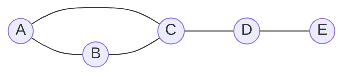

Centrality measures answer the question **"which nodes matter most in a network?"** Each measure formalizes a different meaning of "important": having many connections, being close to everyone, sitting on the routes between others, or being connected to other important nodes. There is no single best measure; the right one depends on what flows through the network (information, disease, money, traffic) and what "important" means for the question.

## Running Example

A small undirected network of five nodes: a triangle (A, B, C) with a tail (C, D, E).



All values below are for this graph (verified with NetworkX).

| Node | Degree | Closeness | Betweenness (normalized) |
| ---- | ------ | --------- | ------------------------ |
| A    | 0.50   | 0.57      | 0.00                     |
| B    | 0.50   | 0.57      | 0.00                     |
| C    | 0.75   | 0.80      | 0.67                     |
| D    | 0.50   | 0.67      | 0.50                     |
| E    | 0.25   | 0.44      | 0.00                     |

Note how D ties with A and B on degree (2 connections each) but has far higher betweenness: it is the only link between E and the rest. That gap is the point of betweenness.

## Degree Centrality

The number of edges at a node, usually divided by the maximum possible ($n-1$):

$$C_D(v) = \frac{\deg(v)}{n-1}$$

- **Meaning:** local popularity or immediate reach. Cheap to compute.
- **Directed graphs:** split into in-degree (popularity, how many point to you) and out-degree (activity, how many you point to).
- **Limit:** ignores the wider structure. A node linked to ten obscure nodes scores the same as one linked to ten hubs.

Example: C has 3 neighbors out of a possible 4, so $C_D(C) = 3/4 = 0.75$.

## Closeness Centrality

The inverse of a node's average shortest-path distance to all others:

$$C_C(v) = \frac{n-1}{\sum_{u \neq v} d(v,u)}$$

- **Meaning:** how quickly a node can reach everyone, such as how fast news from it spreads.
- **Limit:** undefined on disconnected graphs (infinite distances). **Harmonic centrality**, $\sum_{u \neq v} 1/d(v,u)$, fixes this because unreachable nodes contribute zero.

Example: C reaches A, B, D in 1 step and E in 2, so the distance sum is 5 and $C_C(C) = 4/5 = 0.80$. E is the farthest: its distance sum is 9, giving $4/9 = 0.44$.

## Betweenness Centrality

The fraction of all shortest paths between other node pairs that pass through a node:

$$C_B(v) = \sum_{s \neq v \neq t} \frac{\sigma_{st}(v)}{\sigma_{st}}$$

where $\sigma_{st}$ is the number of shortest paths from $s$ to $t$ and $\sigma_{st}(v)$ is how many of them go through $v$. It is usually normalized by the number of node pairs, $(n-1)(n-2)/2$ for undirected graphs, so values fall between 0 and 1.

- **Meaning:** brokerage and control over flow. High-betweenness nodes are **bridges and bottlenecks**: removing them fragments the network or lengthens routes.
- **Same idea for edges:** *edge betweenness* finds the links carrying the most traffic (used in the Girvan-Newman community detection algorithm).
- **Cost:** computed exactly with Brandes' algorithm; on large graphs it is often approximated by sampling source nodes.
- **Weights:** with weighted edges, "shortest" means smallest total weight, so edge weights must be distances (costs), not strengths.

Example: C lies on the only shortest paths for A-D, A-E, B-D, B-E, so its raw betweenness is 4; dividing by 6 pairs gives 0.67. D lies on A-E, B-E, and C-E: raw 3, normalized 0.50. A, B, and E sit on no one else's shortest paths, so their betweenness is 0.

## Eigenvector Centrality, Katz, and PageRank

These measures say a node is important **if it is connected to important nodes**.

- **Eigenvector centrality:** a node's score is proportional to the sum of its neighbors' scores, $\lambda x_v = \sum_u A_{vu} x_u$. The solution is the leading eigenvector of the adjacency matrix $A$.
- **Katz centrality:** counts all walks from a node, discounting longer ones by a factor $\alpha$: $x = \alpha A^{\top} x + \beta$. It stays well behaved on directed graphs where eigenvector centrality can collapse to zero.
- **PageRank:** Katz-like scoring with a random surfer who follows links with probability $d$ (typically 0.85) and jumps to a random node otherwise. Designed for ranking web pages in directed graphs.

### Eigenvector centrality in detail

The recursive definition ("important nodes link to important nodes") resolves into $A x = \lambda x$. By the Perron-Frobenius theorem, a connected graph has a single non-negative eigenvector for the largest eigenvalue, and that is the centrality vector. **Power iteration** finds it: start with equal scores, repeatedly replace each node's score with the sum of its neighbors' scores, and rescale until the scores stop changing.

Weakness: in a directed graph, a node with no incoming edges scores 0 and passes nothing on, so everything downstream can collapse to 0.

### PageRank in detail

PageRank models a **random surfer** who follows a random outgoing link with probability $d$ (the damping factor, 0.85 by default in NetworkX) and jumps to a random node with probability $1-d$:

$$PR(v) = \frac{1-d}{n} + d \sum_{u \to v} \frac{PR(u)}{\text{out-deg}(u)}$$

- A node splits its score among the nodes it links to, so a link from a selective page counts for more than one from a page with many outlinks.
- The random jump keeps every node's score above zero and makes the iteration converge.
- **Dangling nodes** (no outgoing links) are handled by jumping; NetworkX lets you set this with the `dangling` argument, and `personalization` biases the jumps toward chosen nodes.
- NetworkX uses power iteration and raises `PowerIterationFailedConvergence` if it does not converge within `max_iter` (default 100). Undirected graphs are treated as directed with two edges per original edge.

### Comparison on the running example

| Node | Degree | Betweenness | Eigenvector | PageRank |
| ---- | ------ | ----------- | ----------- | -------- |
| A    | 0.50   | 0.00        | 0.50        | 0.19     |
| B    | 0.50   | 0.00        | 0.50        | 0.19     |
| C    | 0.75   | 0.67        | 0.60        | 0.28     |
| D    | 0.50   | 0.50        | 0.34        | 0.21     |
| E    | 0.25   | 0.00        | 0.16        | 0.12     |

Eigenvector scores are unit-length and PageRank scores sum to 1 (both computed with NetworkX), so compare rankings, not raw values. D ties with A and B on degree but ranks lower on eigenvector centrality because its neighbors (C and E) are weaker than A's and B's, while betweenness ranks it higher because it bridges the tail. The two measures answer different questions.

*Source: [NetworkX: pagerank](https://networkx.org/documentation/stable/reference/algorithms/generated/networkx.algorithms.link_analysis.pagerank_alg.pagerank.html), citing Page, Brin, Motwani and Winograd (1999).*

## Choosing a Measure

| Question | Measure |
| -------- | ------- |
| Who has the most direct contacts? | Degree |
| Who can reach (or spread to) everyone fastest? | Closeness or harmonic |
| Who controls the flow or links separate groups? | Betweenness |
| Who is connected to influential nodes? | Eigenvector, Katz, PageRank |

The measures often correlate, but the interesting cases are where they disagree: a low-degree, high-betweenness node is a broker, and a high-degree, low-betweenness node sits inside a dense cluster.

## Code (NetworkX)

```python
import networkx as nx

G = nx.Graph([("A", "B"), ("A", "C"), ("B", "C"), ("C", "D"), ("D", "E")])

nx.degree_centrality(G)        # {'C': 0.75, ...}
nx.closeness_centrality(G)     # C: 0.80, E: 0.44
nx.betweenness_centrality(G)   # C: 0.67, D: 0.50, others 0
nx.betweenness_centrality(G, normalized=False)  # C: 4.0, D: 3.0
nx.eigenvector_centrality(G)
nx.pagerank(G, alpha=0.85)
```

For very large graphs, `betweenness_centrality(G, k=100)` samples 100 source nodes to approximate the result.

## Sources
- [NetworkX: Centrality algorithms](https://networkx.org/documentation/stable/reference/algorithms/centrality.html)
- [NetworkX: betweenness_centrality](https://networkx.org/documentation/stable/reference/algorithms/generated/networkx.algorithms.centrality.betweenness_centrality.html) (definition, normalization, sampling; credits Brandes, 2001)

*Verification: the worked-example numbers were computed with NetworkX. Definitions of betweenness and its normalization match the NetworkX docs. The closeness, eigenvector, Katz and PageRank formulas, the harmonic-centrality fix, and the Girvan-Newman remark are standard results written from memory rather than checked against a source. Please check the sources.*

## Related Notes
- [[Bipartite Networks]] - Centrality when nodes come in two types.
- [[Distributed Machine Learning and Graph Processing]] - Computing graph measures at scale (GraphX, Giraph, Neo4j).
- [[2. Linear Algebra]] - Eigenvectors behind eigenvector centrality and PageRank.
- [[Correlation Coefficients]] - Comparing how different centrality rankings agree.
