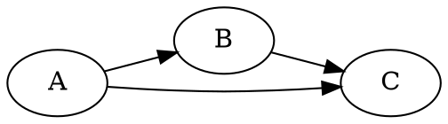

Three tools cover most small-to-medium network work, and they do different jobs: **NetworkX analyzes**, **Gephi explores visually**, and **Graphviz draws fixed diagrams**.

| | NetworkX | Gephi | Graphviz |
| --- | --- | --- | --- |
| **What it is** | Python library for building and analyzing graphs | Open-source desktop application for visual network analysis | Open-source layout and rendering tool driven by a text language (DOT) |
| **Interface** | Code, usually in notebooks | Point-and-click | Command line or code that writes DOT files |
| **Strengths** | Scriptable, reproducible, many algorithms (centrality, bipartite tools, projections, communities) | Interactive filtering, styling nodes by metric, built-in community and centrality measures, fast force-directed layouts | Clean, reproducible static diagrams defined in text |
| **Output** | Numbers and plots | Interactive view; exports PNG, PDF, SVG | PNG, SVG, PDF and other image formats |
| **Scale** | Pure Python, slows down on very large graphs | Advertised range of ten to ten million nodes | Readable up to a few hundred nodes |

## NetworkX

A Python package with no dedicated graph classes for special cases: bipartite graphs, for example, are ordinary `Graph` objects with a node attribute or an explicit node set passed to the `bipartite` functions. It provides centrality measures (degree, closeness, betweenness, eigenvector, Katz, PageRank and many more), bipartite projections and clustering, matching, and graph generators. Betweenness supports sampling (`k`) to approximate results on large graphs. See [[Centrality Measures]] and [[Bipartite Networks]] for worked examples.

## Gephi

An open-source desktop application (GPL) for visual network analysis. It computes community and centrality measures, lets you filter interactively, and styles nodes and edges by data attributes, with layout algorithms such as ForceAtlas 2, Fruchterman-Reingold, and OpenOrd. It exports PNG, PDF, and SVG. Related options on the project site include Gephi Lite (in the browser) and plugins.

## Graphviz

Graphviz turns a text description of a graph (the DOT language) into a laid-out diagram:



```bash
dot -Tpng graph.dot -o graph.png
```

Layout engines:

| Engine | Style | Typical use |
| ------ | ----- | ----------- |
| `dot` | Hierarchical (layered) | Directed graphs, flowcharts, dependencies |
| `neato` | Spring model | Small undirected graphs |
| `fdp` | Force-directed placement | Undirected graphs with clusters |
| `sfdp` | Scalable force-directed | Larger graphs |
| `circo` | Circular | Cyclic structures |
| `twopi` | Radial | Hub-and-spoke structures |
| `osage` | Clustered | Clustered graphs |
| `patchwork` | Squarified treemap | Map-style view of clustered graphs |

Graphviz has no analysis functions and no interactive filtering.

## A Typical Workflow

1. Build and clean the graph in NetworkX.
2. Compute metrics there (betweenness, PageRank, communities).
3. Export to a file such as GEXF or GraphML, open it in Gephi, and size nodes by betweenness and color them by community.
4. For documentation, export a small graph to DOT and render it with Graphviz.

## Caveats and Alternatives

- Force-directed layouts are visual aids, not measurements: position has no exact meaning.
- For larger graphs, igraph and graph-tool are faster than NetworkX; Neo4j and the distributed engines in [[Distributed Machine Learning and Graph Processing]] cover graph databases and scale-out processing; PyTorch Geometric and DGL are used for [[Graph Neural Networks]].

## Sources
- [Gephi](https://gephi.org/)
- [Graphviz layout engines](https://graphviz.org/docs/layouts/)
- [NetworkX: Bipartite](https://networkx.org/documentation/stable/reference/algorithms/bipartite.html) and [Centrality](https://networkx.org/documentation/stable/reference/algorithms/centrality.html)

*Verification: the Gephi features, license, layouts, and exports and the Graphviz engine descriptions were read on the official sites. The graph-size comparisons for NetworkX and Graphviz, the file-format workflow (GEXF, GraphML), and the alternatives (igraph, graph-tool, Neo4j, PyTorch Geometric, DGL) are from memory and not checked. Please check the sources.*

## Related Notes
- [[Centrality Measures]] - Metrics you compute with NetworkX and visualize in Gephi.
- [[Bipartite Networks]] - Two-mode graphs and projections.
- [[Distributed Machine Learning and Graph Processing]] - Graph tools at scale.
