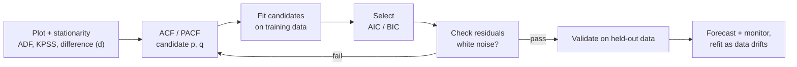

An **autoregressive (AR) model** predicts a value from its own past values. It is the basic building block of classical time-series forecasting, and it extends into ARMA, ARIMA, and seasonal models. Autocorrelation ideas come from [[Correlation Coefficients]]; the tests and p-values below build on [[Statistical Inference Basics]].

$$X_t = c + \phi_1 X_{t-1} + \phi_2 X_{t-2} + \dots + \phi_p X_{t-p} + \varepsilon_t \qquad \text{AR}(p)$$

$p$ is the number of lags and $\varepsilon_t$ is the unexplained error at time $t$.

## What Makes a Model Autoregressive
The defining question is **whether the model uses earlier values of the thing it predicts**, not the model type. "Autoregressive" is a property of the predictors.

| Model | Predictors | Autoregressive? |
| :-- | :-- | :-- |
| Linear regression of $y_t$ on temperature or hour of day | Other variables | No |
| Linear regression of $y_t$ on $y_{t-1}, y_{t-2}$ | Its own past | Yes: AR(2) |
| Logistic regression of "alert this hour?" on the previous hours' alert status | Its own past | Yes: autoregressive logistic |
| Logistic regression on speed and location | Other variables | No |

Swapping the link function gives **autoregressive GLMs**: a logistic link for binary outcomes, a Poisson or negative-binomial link for counts, each with a linear predictor built from lagged terms.

"Autoregressive" also is not limited to time. It means predicting the next element from earlier ones in some ordering:

| Family | Ordering | Notes |
| :-- | :-- | :-- |
| AR, ARMA, ARIMA, SARIMA, VAR | Time | Classical statistics |
| Spatial autoregressive (SAR) | Space (neighbors) | Value depends on nearby locations |
| LLMs, PixelCNN, WaveNet | Token, pixel, or sample order | Generative models that predict the next element |

## The Model Family

| Model | Predicts from | Handles |
| :-- | :-- | :-- |
| **AR($p$)** | Past values | Persistence |
| **MA($q$)** | Past errors (shocks) | Short-lived shocks that fade after $q$ steps |
| **ARMA($p,q$)** | Past values and past errors | Both, in fewer parameters |
| **ARIMA($p,d,q$)** | ARMA on the series differenced $d$ times | Trends |
| **SARIMA($p,d,q$)($P,D,Q$)$_m$** | ARIMA plus seasonal terms with period $m$ | Seasonality (for example $m=24$ for hourly data with a daily cycle) |
| **ARIMAX / SARIMAX** | Adds external (exogenous) inputs | Weather, holidays |

An MA($q$) model is $X_t = \mu + \varepsilon_t + \sum_{j=1}^q \theta_j \varepsilon_{t-j}$. Here $\varepsilon_t$ is whatever the model could not predict at time $t$, and a one-off shock appears in the readings at $t, t+1, \dots, t+q$ and then vanishes. This is why the ACF of an MA($q$) cuts off after lag $q$. The name is misleading: it is not a smoothing moving average.

In ARIMA($p,d,q$): $p$ is the number of past values, $d$ the number of times the series is differenced, and $q$ the number of past errors.

| Order | Model |
| :-- | :-- |
| $(p,0,0)$ | AR($p$) |
| $(0,0,q)$ | MA($q$) |
| $(p,0,q)$ | ARMA($p,q$) |
| $(0,1,0)$ | Random walk |

## Assumptions: Linearity and Stationarity
See [[Stationarity and Unit Roots]] for the full treatment, [[ARMA and ARIMA Models]] for the mixed and integrated models, and [[Vector Autoregression]] for several series.

- **Linearity:** classic AR is a linear combination of lags. Relaxations: threshold and smooth-transition AR, and neural autoregressive models (NARX, DeepAR, LSTM and Transformer forecasters). It is linear in its parameters, so transformed lags (squares, logs) are possible.
- **Stationarity:** roughly constant mean, variance, and autocorrelation over time; formally, all roots of the characteristic polynomial lie outside the unit circle. It is needed for the standard theory and stable forecasts, not for being able to run the fit.

| Situation | What happens |
| :-- | :-- |
| Trend or seasonality | Not stationary; difference (the "I" in ARIMA), detrend, or add seasonal terms |
| Unit root ($\phi_1=1$, a random walk) | Fit runs but estimates and tests behave unusually; forecasts do not revert to a mean |
| Structural breaks | One fixed AR is wrong across the break; use regime-switching or time-varying AR, or refit on recent data |
| Several trending series with a stable relationship | Cointegration (vector error-correction models) |

### Stationarity tests

| Test | Null hypothesis | Small p-value means |
| :-- | :-- | :-- |
| **ADF** (Augmented Dickey-Fuller) | Unit root (non-stationary) | Evidence the series is stationary |
| **KPSS** | Stationary | Evidence the series is non-stationary |

| ADF | KPSS | Conclusion |
| :-- | :-- | :-- |
| Rejects | Does not reject | Stationary |
| Does not reject | Rejects | Non-stationary: difference it |
| Rejects | Rejects | Conflicting: often trend-stationary or a structural change |
| Does not reject | Does not reject | Inconclusive: little data or low power |

Choose the deterministic term (constant, or constant plus trend) to match the series. Both tests have low power on short series, so pair them with a plot.

## Why Identify the Order
The true model is unknown: nature does not label a series "AR(2)". We choose a model that approximates the data. Too few terms underfit and leave structure in the residuals; too many overfit and forecast worse; the wrong family (AR on a strongly trending series) gives misleading results. This is the identify, estimate, check cycle of the **Box-Jenkins** method.

### Finding $d$, $p$, $q$
1. **$d$:** plot the series, run ADF/KPSS, difference until stationary; use the smallest $d$ that works (usually 0 or 1, rarely 2). Over-differencing adds noise, signaled by a strongly negative lag-1 autocorrelation.
2. **$p$ and $q$:** read the ACF and PACF of the stationary series.

| Pattern | ACF | PACF | Suggests |
| :-- | :-- | :-- | :-- |
| AR($p$) | Decays gradually | **Cuts off** after lag $p$ | AR |
| MA($q$) | **Cuts off** after lag $q$ | Decays gradually | MA |
| Both decay | Decays | Decays | ARMA |
| Slowly decaying ACF with a strong trend | Barely decays | | Difference first |

Real plots rarely show a clean cutoff, so the reading gives starting guesses only.
3. **Confirm by search:** fit a small grid of orders around the guess and keep the lowest AIC or BIC (the simpler model if scores are close).
4. **Check** the winner's residuals, then validate on held-out data.

## Information Criteria
A criterion scores a model by balancing fit against complexity. Fit alone always favors the biggest model, so a penalty per parameter is added:

$$\text{criterion} = -2\ln\hat L + \text{penalty}(k,n)$$

| Criterion | Formula | Tendency |
| :-- | :-- | :-- |
| **AIC** | $-2\ln\hat L + 2k$ | Favors predictive accuracy; slightly larger models |
| **HQC** | $-2\ln\hat L + 2k\ln(\ln n)$ | Between AIC and BIC; consistent |
| **BIC** | $-2\ln\hat L + k\ln n$ | Strictest for $n>7$; prefers simpler models; consistent |
| **AICc** | AIC with a small-sample correction | Use when $n$ is small relative to $k$ |

Illustrative numbers ($n=200$, $k$ = lag coefficients plus constant and variance):

| Model | $k$ | $-2\ln\hat L$ | AIC | BIC |
| :-- | :-- | :-- | :-- | :-- |
| AR(1) | 3 | 540 | 546 | 555.9 |
| AR(2) | 4 | 520 | 528 | 541.2 |
| AR(3) | 5 | 518 | 528 | 544.5 |
| AR(4) | 6 | 517 | 529 | 548.8 |

AIC ties AR(2) and AR(3); BIC clearly picks AR(2). Rules of use:
- Compare only models fit to the **same observations** (higher lags drop initial rows).
- Read **differences**, not raw values: a gap under about 2 is a near tie, above about 10 is strong evidence.
- They rank candidates, they do not validate them: check residuals.
- AIC for forecasting, BIC for parsimony or interpretation.

### Likelihood ratio test (LRT)
Not an information criterion but a significance test between **nested** models (AR(2) is AR(3) with $\phi_3=0$):

$$\text{LR} = 2\big(\ln\hat L_{\text{large}} - \ln\hat L_{\text{small}}\big) \sim \chi^2_{\Delta k}$$

With the numbers above, AR(2) vs. AR(3) gives $\text{LR}=2$, $\Delta k=1$, $p\approx0.16$: the extra lag is not significant, agreeing with BIC. Information criteria rank any set of models in one pass and need no $\alpha$; the LRT needs nesting and a chosen $\alpha$.

## Fitting the Parameters
Orders are **chosen**; coefficients ($\phi_i$, $\theta_j$, $c$, $\sigma^2$) are **estimated**. Fitting means finding the parameters that best match the training data; it is not just computing an error. In-sample error after fitting is optimistic, which is why penalties and held-out tests exist.

| Model | Method | Gradient updates? |
| :-- | :-- | :-- |
| AR | **OLS (conditional least squares):** regress on lags, $\hat\phi=(X^\top X)^{-1}X^\top y$; loses the first $p$ observations | No, closed form |
| AR | **Yule-Walker:** solve $\gamma(k)=\sum_i\phi_i\gamma(k-i)$ from sample autocovariances; guarantees a stationary fit, can be biased on short series | No, closed form |
| AR | **Burg:** minimizes forward and backward prediction errors; good for short series | No |
| AR, ARMA, ARIMA | **Maximum likelihood**, basis of AIC/BIC | Yes for MA terms |
| MA, ARMA, ARIMA | Past errors are unobserved and depend on the parameters, so no closed form: numerical optimizer (quasi-Newton such as BFGS), likelihood via the Kalman filter, conditional sum of squares for starting values | Yes, a few iterations, not epochs |
| Neural autoregressive models | Stochastic gradient descent over epochs | Yes |

When to fit: after identification, for each candidate on **training data only**; refit on all data before real forecasts; refit on a schedule or when forecast error rises. Check convergence, roots in the stationary region, and residuals.

```python
import itertools
from statsmodels.tsa.ar_model import AutoReg
from statsmodels.tsa.arima.model import ARIMA

ar = AutoReg(train, lags=2).fit()                 # OLS
print(ar.aic, ar.bic)

d = 1
best = min(((p, d, q) for p, q in itertools.product(range(4), range(3))),
           key=lambda o: ARIMA(train, order=o).fit().aic)

fc = ar.predict(start=len(train), end=len(train) + 9)   # 10 steps ahead
```
*Not executed: `statsmodels` was not installed when this was written.* Related tooling: `ar_select_order(series, maxlag, ic="aic")` (also `"bic"`, `"hqic"`) compares lags automatically, and `pmdarima.auto_arima` automates the order search including seasonal terms.

## Using a Fitted Model

| Use | How |
| :-- | :-- |
| **Diagnostics** | Residuals should be white noise: no ACF spikes (Ljung-Box p-value large), no pattern, mean near zero |
| **One-step forecast** | Predict $X_{t+1}$ from the observed past; most accurate |
| **Multi-step forecast** | Recursive: feed each forecast back in; errors accumulate and a stationary AR reverts to the mean, so long horizons are uninformative |
| **Prediction intervals** | Always report; they widen with the horizon |
| **Evaluation** | Time-based split (never shuffle) or rolling-origin walk-forward evaluation; MAE, RMSE, or MAPE (avoid near zero); compare against a simple baseline such as last value or last season |
| **Anomaly detection** | Large residual (for example beyond $3\sigma$ of training residuals) signals a fault, attack, or regime change |
| **Understanding** | Coefficients show persistence and how fast shocks fade; simulate paths from the fitted model |
| **Maintenance** | Refit regularly; watch for structural breaks |



## Applications

| Domain | Use |
| :-- | :-- |
| Finance | Forecast prices, inflation, interest rates |
| Wireless communications | Model fading channels and signal variations |
| Medical signals | Analyze ECG/EEG for anomalies |
| Predictive maintenance | Detect equipment wear from vibration data |
| Climate and weather | Predict temperature and rainfall |
| Social sciences | Model unemployment and consumer trends |
| Network traffic | Forecast next-minute packet rate or bandwidth |

**Example: network traffic forecasting.** Data-center and 5G networks log traffic continuously. A typical big data pipeline ingests logs with Kafka or Flume, stores them in HDFS, S3, or Cassandra, and fits AR models per node or partition in Spark ([[Stream Processing and Event Streaming]], [[Apache Spark]]). Forecasts support load balancing (reroute before congestion), capacity planning, and anomaly detection (predicted vs. actual flags DDoS or faults), with Grafana or Kibana comparing real and predicted traffic. Spark MLlib has no built-in AR or ARIMA model, so the usual approach is one `statsmodels` fit per group using a grouped pandas function (`applyInPandas`). Reported efficiency gains such as "10 to 20 percent" are illustrative and uncited.

## Limitations
Assumes linearity and stationarity, is sensitive to noise, and cannot capture nonlinear dynamics without extensions. Extend it with ARIMA, SARIMA, nonlinear AR, or ML models, and keep a simple baseline to justify any added complexity.
