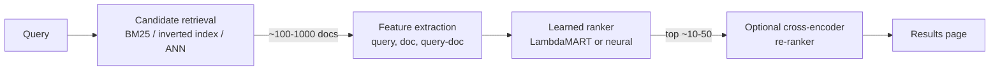

Learning to Rank (LTR) is a class of supervised machine learning algorithms designed to sort a list of items based on their relevance to a specific query. While classical machine learning models (like classification or regression) predict single values from a feature vector, LTR models evaluate a set of feature vectors to output an optimal ordering.

## Core Concepts

In LTR, the system receives an n-dimensional feature vector containing information about a query and a document. The goal is to learn a function that outputs a relevance score, allowing documents to be ranked such that highly relevant documents appear at the top of the search results.

Feature vectors in LTR generally incorporate:
1. **Document-only features:** e.g., document length, number of links.
2. **Query-only features:** e.g., query length, term frequency of the query.
3. **Query-document combination features:** e.g., TF-IDF, BM25, number of matching words.

### Training Data Collection

LTR relies on "ground truth" training data to teach the model what an ideal set of ranked results looks like:
- **Offline LTR:** Relies on manual annotation by human experts rating query-document pairs. It provides high-quality data but is time-consuming and expensive.
- **Online LTR:** Implicitly collects user interaction signals, such as clicks, views, or time spent on a page. While easier to scale, the data can be noisy and harder to interpret.

## Ranking Approaches

Most LTR algorithms use stochastic gradient descent to optimize ranking. Depending on how the algorithm compares items during training, there are three primary approaches:

### Pointwise Ranking

- **Mechanism:** Predicts an independent score for each document feature vector.
- **Problem Formulation:** Casts ranking as a regression or classification problem.
- **Drawbacks:** It optimizes scores independently and ignores relative document order. This means a model might achieve a lower overall loss but still display irrelevant results at the top, negatively impacting user experience. It also suffers from severe class imbalance since most documents are irrelevant to any given query.

### Pairwise Ranking

- **Mechanism:** Compares documents in pairs. The model predicts the probability that document A should be ranked higher than document B.
- **Loss Function:** Uses pairwise loss (e.g., cross-entropy on the softmax of the difference between document scores). 
- **Algorithms:** RankNet is a foundational algorithm that minimizes the number of rank inversions.
- **Drawbacks:** Optimizing for the fewest number of inversions is not always ideal. Users care most about the absolute top results. A ranking with fewer overall inversions might push a highly relevant result out of the #1 spot, which hurts user-centric metrics like nDCG.

### Listwise Ranking

- **Mechanism:** Takes entire lists of documents as input and directly optimizes ranking metrics (like nDCG or precision).
- **Algorithms:** 
  - **LambdaRank:** An extension of RankNet where the gradient "lambdas" are multiplied by the change in nDCG that would result from swapping two documents. This effectively forces the model to prioritize getting the top results right.
  - **LambdaMART:** Combines LambdaRank with gradient boosted trees. It is highly effective and widely used in practice.
  - **SoftRank:** Creates a differentiable approximation of nDCG ("SoftNDCG") so it can be optimized directly via gradient descent.

## Where LTR Sits in a Search Pipeline

Scoring every document with a heavy model is too slow, so production systems rank in stages. Cheap retrieval narrows millions of documents to a few hundred candidates, and the learned ranker re-scores only those.



## Evaluation Metrics

Ranking quality is measured per query and averaged, with a cutoff $k$ because users rarely look past the first page.

| Metric | What it rewards | Label type |
|---|---|---|
| Precision@k | Fraction of the top $k$ that is relevant | Binary |
| MAP | Relevant items appearing early, averaged over recall levels | Binary |
| MRR | Rank of the first relevant item | Binary |
| nDCG@k | Graded relevance, with a logarithmic discount on position | Graded (0-4) |

$$\mathrm{DCG@}k = \sum_{i=1}^{k} \frac{2^{rel_i} - 1}{\log_2(i+1)}, \qquad \mathrm{nDCG@}k = \frac{\mathrm{DCG@}k}{\mathrm{IDCG@}k}$$

Here $rel_i$ is the label of the item at position $i$ and IDCG is the DCG of the ideal ordering, so nDCG lies in $[0, 1]$. Implementations differ on queries with no relevant items (XGBoost and LightGBM score them as 1), so compare numbers across tools with care.

## Models Used

| Family | Model | Approach | Notes |
|---|---|---|---|
| Linear | RankSVM (SVMrank) | Pairwise | Hinge loss on score differences; a classic baseline |
| Neural | RankNet | Pairwise | Logistic loss on score differences, trained by gradient descent |
| Neural | ListNet / ListMLE | Listwise | Loss over the probability distribution of permutations |
| Boosted trees | LambdaMART | Listwise (lambda gradients) | Boosted [[Decision Trees]] trained with metric-weighted gradients; the default strong choice on tabular features |
| Boosted trees | RankBoost, AdaRank, Coordinate Ascent | Pairwise / listwise | Older methods available in RankLib |
| Transformers | Cross-encoder (monoBERT, monoT5) | Pointwise or pairwise | Reads query and document together; accurate but slow, so used on the top candidates only |
| Transformers | Bi-encoder / dense retrievers | Pairwise (contrastive) | Embeds query and document separately; used for the retrieval stage |

LambdaMART remains the workhorse for structured feature vectors, and it is a direct application of [[Boosting]]: each new tree fits the lambda gradients, which are RankNet's pairwise gradients scaled by the nDCG change from swapping two documents. For text, [[BERT]]-style cross-encoders built on [[Attention & Transformers]] are typically stacked after a LambdaMART or BM25 stage. Neural rankers on tabular LTR features often only match tuned LambdaMART, so boosted trees are the sensible first baseline.

## Libraries and Frameworks

| Library | Language | Ranking support |
|---|---|---|
| [LightGBM](https://lightgbm.readthedocs.io/) | Python, C++ | `LGBMRanker` with `lambdarank` and `rank_xendcg` objectives |
| [XGBoost](https://xgboost.readthedocs.io/en/stable/tutorials/learning_to_rank.html) | Python, C++ | `XGBRanker` with `rank:ndcg` (default), `rank:map`, `rank:pairwise` |
| CatBoost | Python, C++ | Ranking objectives such as `YetiRank` and `PairLogit` |
| TensorFlow Ranking | Python | Pointwise, pairwise, and listwise losses for Keras models |
| allRank | Python (PyTorch) | Neural rankers including transformer-based listwise models |
| RankLib | Java | RankNet, RankBoost, AdaRank, Coordinate Ascent, LambdaMART, ListNet, Random Forests |
| sentence-transformers | Python | `CrossEncoder` re-rankers and bi-encoders for text |
| PyTerrier, Pyserini | Python | Full IR pipelines (retrieve, then re-rank) and standard benchmark evaluation |
| Elasticsearch/OpenSearch LTR, Solr LTR, Vespa | Server | Serve a trained model inside the search engine to re-score candidates |

Gradient-boosted libraries are by far the most common choice in industry because they train fast, handle missing values, and are easy to deploy. Search engines usually train offline in Python and export the model (for example as XGBoost JSON or a LightGBM model file) for the engine to execute at query time.

## Datasets and Input Data

### Benchmark datasets

| Dataset | Queries | Features | Labels | Notes |
|---|---|---|---|---|
| [MSLR-WEB10K / WEB30K](https://www.microsoft.com/en-us/research/project/mslr/) | 10,000 / 30,000 | 136 | 0-4 | Bing query-URL pairs; WEB10K is a sample of WEB30K; five folds |
| Yahoo Learning to Rank Challenge | ~30,000 | ~700 | 0-4 | Fixed train/validation/test split |
| Istella (S, X) | Tens of thousands | 220 | 0-4 | Italian web search; Istella-X is much larger |
| LETOR 4.0 (MQ2007, MQ2008) | ~1,700 / ~800 | 46 | 0-2 | Small, good for quick experiments |
| MS MARCO, TREC Deep Learning | Hundreds of thousands (MARCO) | Raw text | Sparse binary / graded | Text ranking; used to train and test neural re-rankers |
| BEIR | Many | Raw text | Varies | Zero-shot retrieval and re-ranking across 18 datasets |
| Expedia hotel search (Kaggle) | Search sessions | Hotel and user attributes | Clicked / booked | Real e-commerce ranking with implicit feedback |

### Input format

Feature-based LTR data uses the SVMlight/LETOR text format: one line per query-document pair, with the relevance label, the query ID, then sparse `index:value` features. Rows of the same query must be contiguous because the library needs to know where each query's list starts and ends.

Illustrative values, truncated to 10 features:

```text
# label qid:<query id> <feature index>:<value> ...
2 qid:1 1:3 2:0 3:2 4:0 5:3 6:1.0 7:0.667 8:0.0 9:1.0 10:0.5
0 qid:1 1:1 2:0 3:0 4:0 5:1 6:0.333 7:0.0 8:0.0 9:0.5 10:0.1
1 qid:1 1:2 2:1 3:0 4:0 5:3 6:0.667 7:0.5 8:0.0 9:0.8 10:0.3
4 qid:2 1:3 2:3 3:3 4:1 5:3 6:1.0 7:1.0 8:1.0 9:0.9 10:0.7
0 qid:2 1:0 2:0 3:0 4:0 5:0 6:0.0 7:0.0 8:0.0 9:0.1 10:0.0
```

In memory, the same data becomes three aligned objects:

| Object | Shape | Example |
|---|---|---|
| `X` | (n_docs, n_features) | One feature vector per query-document pair |
| `y` | (n_docs,) | Graded labels such as `[2, 0, 1, 4, 0]` |
| `group` / `qid` | per query | LightGBM: list of group sizes `[3, 2]`; XGBoost: per-row query IDs `[1, 1, 1, 2, 2]` |

The 136 features of MSLR-WEB cover the three families above: query-document match statistics (term coverage, TF-IDF, BM25, language-model scores) across the title, body, anchor text, URL, and whole document, plus document-only signals such as PageRank, URL length, and document length.

### Example: training a LambdaMART ranker

Synthetic data with graded labels, 200 queries of 20 candidate documents each. Not executed in this vault's environment; the API usage follows the library docs.

```python
import numpy as np
import lightgbm as lgb
from sklearn.metrics import ndcg_score

rng = np.random.default_rng(0)
n_queries, docs_per_query, n_features = 200, 20, 10
X = rng.normal(size=(n_queries * docs_per_query, n_features))
signal = X[:, 0] + 0.5 * X[:, 1] + rng.normal(scale=0.5, size=len(X))
y = np.digitize(signal, np.quantile(signal, [0.5, 0.75, 0.9, 0.97]))  # labels 0-4
group = np.full(n_queries, docs_per_query)  # rows are contiguous per query

split = 150 * docs_per_query  # split by query, never inside a query
ranker = lgb.LGBMRanker(objective="lambdarank", metric="ndcg",
                        n_estimators=200, learning_rate=0.05)
ranker.fit(X[:split], y[:split], group=group[:150],
           eval_set=[(X[split:], y[split:])], eval_group=[group[150:]],
           eval_at=[5, 10])

scores = ranker.predict(X[split:]).reshape(-1, docs_per_query)
print(ndcg_score(y[split:].reshape(-1, docs_per_query), scores, k=10))
```

At inference time the model only produces a score per candidate; sorting by that score within each query gives the final ranking. Always split train and test by query so no query appears on both sides.

### Using clicks as labels

When there are no human judgments, clicks and purchases from logs serve as labels. They are biased toward items shown at the top (position bias), so naive training mostly learns the old ranker's ordering. Common remedies are inverse propensity weighting, click models, and adding position as a feature that is fixed at inference. XGBoost's docs include a simulated-click example for this case.

## Industry Applications

LTR is primarily used in scenarios requiring sophisticated relevancy sorting:
- **Search Engines:** Ordering web pages so the most relevant appear first.
- **[[Recommendation Systems]]:** Choosing which products or media to recommend to a user.
- **Enterprise Search:** Tools like Lucidworks Fusion leverage Apache Solr's LTR capabilities to replace manual boost/block rules with automated, machine-learned relevancy based on user behavior signals.

## References

- *Source: [Introduction to Ranking Algorithms | Towards Data Science](https://towardsdatascience.com/introduction-to-ranking-algorithms-4e4639d65b8/)*
- *Source: [The ABCs of Learning to Rank | Lucidworks](https://lucidworks.com/blog/abcs-learning-to-rank)*
- *Source: [Learning to Rank | XGBoost documentation](https://xgboost.readthedocs.io/en/stable/tutorials/learning_to_rank.html)*
- *Source: [GBDT LTR | Vespa](https://learn.vespa.ai/reranking-ltr/gbdt-ltr)*
- *Source: [Microsoft Learning to Rank Datasets (MSLR)](https://www.microsoft.com/en-us/research/project/mslr/)*
