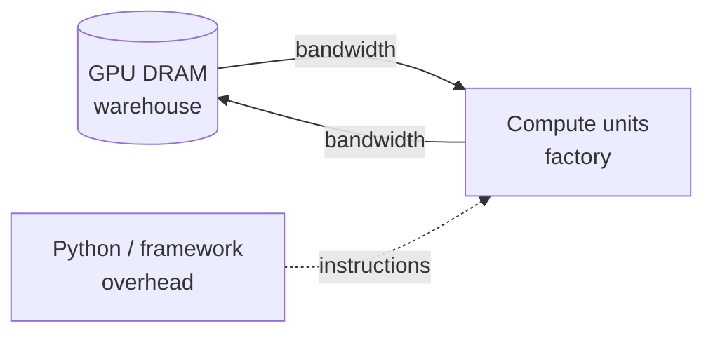

Deep learning speed is rarely limited by how many FLOPs a GPU can do. It is limited by whether the GPU is fed fast enough. This note covers what a GPU kernel is, the three ways a workload can be bottlenecked, and the main fix for the most common one (operator fusion).

## What Is a Kernel?

A **GPU kernel** is a function written for one unit of work (one output element or one tile) that the GPU launches across thousands of threads at once. Each thread reads its own index to know which piece it owns.

```python
# Sketch: element-wise add. One thread handles one element.
def add_kernel(a, b, out):
    i = thread_index()
    out[i] = a[i] + b[i]
```

Kernels are how parallelism is expressed on a GPU, not an alternative to it. Parallelism also exists above the kernel (batching requests, splitting a model across GPUs) and below it (vector lanes). Each operation in a network, such as a matmul, a softmax, or a normalization, runs as one or more kernels, so kernel quality sets the speed of the whole model.

## The Three Bottlenecks

A workload spends its time in one of three places:

| Regime | Time goes to | Typical fix |
|---|---|---|
| **Compute-bound** | Floating-point math | Use tensor cores, lower precision, better algorithms |
| **Memory-bandwidth-bound** | Moving tensors between GPU memory and the compute units | Fuse operations, reuse data on-chip, shrink data |
| **Overhead-bound** | Python, framework dispatch, kernel launches | Larger kernels, fewer ops, compilation, CUDA graphs |

The fix for one regime does nothing for another. Doubling FLOPS does not help a memory-bound job, and rewriting Python in C++ does not help a compute-bound one. Identify the regime before optimizing.

### The factory analogy

Think of the GPU as a factory (compute) with a warehouse (DRAM, the memory that shows up in `nvidia-smi`). Every kernel typically fetches its inputs from the warehouse and ships its outputs back. If trips are slow, the factory sits idle no matter how fast it is.



### Why matmuls dominate the FLOPS story

Peak FLOPS figures assume matrix multiplication on tensor cores. On an A100, the quoted peak is 312 teraflops for matmul but only about 19.5 for other operations. Non-matmul operations such as normalization and pointwise functions are a tiny share of total FLOPs (about 0.2% in a BERT breakdown), yet they take a disproportionate share of runtime because they are bandwidth-limited and run at a small fraction of matmul throughput.

## Arithmetic Intensity

**Arithmetic intensity** (compute intensity) is the number of operations performed per byte or element moved from memory. It decides the regime:

- Low intensity (for example `x * 2`): one read, one multiply, one write. Memory-bound.
- High intensity (for example a large matmul): each loaded value is reused many times. Compute-bound.

Using A100 figures of about 1.5 TB/s of bandwidth and 19.5 TFLOPS, a simple unary float32 operation needs on the order of a hundred operations per element before compute, not memory, becomes the limit.

**Example: sweeping intensity.** Multiply a large tensor by 2 repeatedly inside one kernel. Runtime stays flat up to roughly 32 to 64 repeats, because the kernel is still waiting on memory. Achieved FLOPS climbs linearly with the repeat count until it approaches peak, after which runtime grows, meaning the kernel is now compute-bound.

## Operator Fusion

Running `x.cos().cos()` as two kernels reads and writes the tensor in DRAM twice. A **fused** kernel loads once, applies both operations in registers, and writes once, halving the memory traffic for a 2x speedup.

- Fusion removes the intermediate round trips for chains of pointwise operations and can extend to reductions and matmul epilogues.
- It needs the whole chain in view, so eager execution cannot do it. Compilers (`torch.compile`, XLA, NVFuser) and hand-written kernels in Triton or CUDA do.
- Consequences: a fused `gelu` costs about the same as `relu`, and recomputing a cheap value can be faster than storing and reloading it.
- The same idea powers FlashAttention, which tiles attention so intermediates stay on-chip instead of round-tripping through DRAM.

## Overhead

Small operations expose framework cost. Python executes roughly 32 million additions per second, in the time of which an A100 could perform millions of FLOPs, and PyTorch dispatches on the order of hundreds of thousands of tiny operations per second. PyTorch hides most of this by running asynchronously, queueing GPU kernels ahead of execution, but only if each kernel is large enough to keep the GPU busy while the next one is queued. For small workloads, techniques like CUDA graphs replay a recorded sequence of kernels without per-launch overhead.

## Diagnosing the Regime

1. For a single operator, estimate bytes moved and FLOPs, then compare against hardware peaks.
2. Sweep arithmetic intensity in a microbenchmark and see which resource saturates.
3. For a full model, measure achieved FLOPS as a fraction of peak. 80% of peak means the job is at least 80% compute-bound.
4. Profile for time outside tensor work (flamegraphs, profiler traces) to find overhead.

## Example: A Public Kernel Contest

The [Muse Spark Open Kernel Challenge](https://openkernelchallenge.dev/#get-started) asks participants to beat SGLang's GPU kernels for a large open-weight mixture-of-experts model. Problems include BF16 projections, decode attention, 4-bit-weight MoE layers, and full decode and prefill layers, each timed as a CUDA graph on an H200. Leading entries at the time of writing run about 1.6x to 3x faster than the baseline. The problem set maps onto this note: decode attention is typically memory-bound, large projections are compute-bound, and low-precision weights (W4A16) are a way to cut memory traffic.

## Further Reading

- *Source: [Making Deep Learning Go Brrrr From First Principles](https://horace.io/brrr_intro.html), Horace He.*
- Related notes: [[KV Cache]] (a memory-bandwidth bottleneck in LLM serving), [[Keras vs. PyTorch vs. TensorFlow]], [[Slurm]] (running GPU jobs on clusters).
