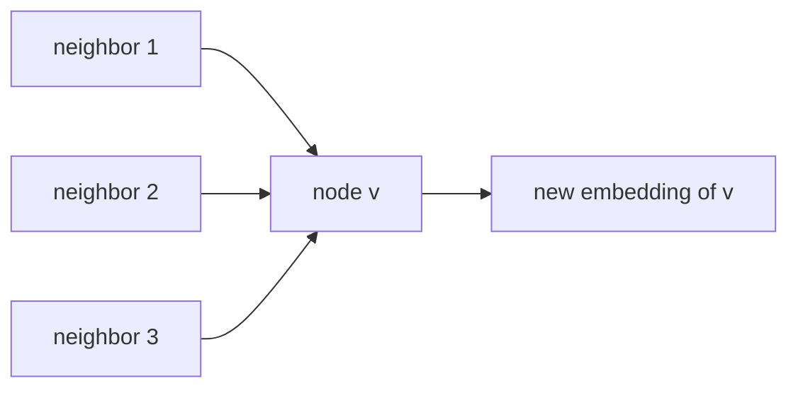

Graph neural networks (GNNs) learn from data shaped as a graph: nodes with features, connected by edges. Instead of a hand-designed score such as [[Centrality Measures]], a GNN learns a vector (embedding) for each node from the graph's structure and the node features together.

## Core Idea: Message Passing

Each layer updates a node by gathering information from its neighbors:

$$h_v^{(k+1)} = \text{UPDATE}\Big(h_v^{(k)},\ \text{AGGREGATE}\big(\{h_u^{(k)} : u \in N(v)\}\big)\Big)$$

- After $k$ layers a node's embedding reflects its **$k$-hop neighborhood**.
- AGGREGATE must not depend on the order of neighbors, since they have no natural ordering. Sum, mean, and max qualify.
- The same weights are shared across all nodes, so the model works on graphs of any size.

## Main Variants

| Model | Idea | Notes |
| ----- | ---- | ----- |
| **GCN** (Kipf and Welling, 2017) | Degree-normalized average of neighbor features, then a linear layer and nonlinearity | Motivated as a first-order approximation of spectral graph convolutions; cost grows linearly with the number of edges; designed for semi-supervised node classification |
| **GraphSAGE** (Hamilton et al., 2017) | Sample a fixed number of neighbors and aggregate their features | Inductive: embeds nodes unseen during training and even unseen graphs; scales to large graphs |
| **GAT** (Velickovic et al., 2018) | Masked self-attention over neighbors, so each neighbor gets a learned weight | Same idea as [[Attention & Transformers]]; works for transductive and inductive problems |
| **MPNN** | General message-passing framework that covers the above | Unifies GCN-style models in one formulation |

## Tasks

- **Node classification:** label nodes (fraud or not, a paper's topic), often with few labeled examples.
- **Link prediction:** predict missing or future edges (recommendation, drug-target interactions).
- **Graph classification:** pool node embeddings into one vector per graph (e.g. molecule properties).

## Connections to Network Analysis

- Centrality measures are fixed functions of structure. A GNN learns its own and can combine structure with node features.
- Bipartite graphs such as user-item networks (see [[Bipartite Networks]]) are the standard setup for graph-based recommendation, with messages passed between the two node types. See also [[Recommendation Systems]].
- A Transformer can be viewed as a GNN on a fully connected graph of tokens, with attention as the aggregation.

## Known Limitations

- **Over-smoothing:** with many layers, node embeddings become nearly identical, so most GNNs are shallow (a few layers).
- **Expressiveness:** standard message-passing GNNs cannot distinguish graphs that the Weisfeiler-Leman isomorphism test cannot.
- **Scale:** neighborhoods grow exponentially with depth, which is why sampling (GraphSAGE) is used.

## Evaluating GNNs on Small Graphs

A worked example: classifying node types and predicting links on a 110-node graph built from a system model (see [[Specification Models as Graphs]]). Both outputs are **review prompts, not corrections**: the node types are already known, so the value of a classifier lies in its disagreements ("type suspects"), and predicted links are pairs a reviewer should look at.

**Features and models**
- Node features: sentence embeddings (all-MiniLM-L6-v2) of the element name, with camelCase split into words so the tokenizer sees real words, plus documentation text. The node type is deliberately kept out of the text because it is the label (see data leakage below). A structure-only variant uses `[1, log(1 + degree)]`.
- Classifier: two-layer GCN (hidden size 64, ReLU, dropout 0.5, Adam with learning rate 0.01, weight decay 5e-4, 200 epochs), compared with an MLP of the same size that ignores the graph.
- A relation-aware model (R-GCN) was not used: 118 relation pairs spread over 19 relation types leave each per-relation weight too little data. The cost is that the plain GCN ignores edge types.
- Link prediction: a separate GCN with a dot-product decoder and binary cross-entropy against sampled negatives, not reused classifier outputs. The final ranking averages 10 models trained on all known relations.

**Evaluation protocol**
- Node types: only types with at least 5 elements are scored (11 types, 93 of 110 nodes); stratified 5-fold cross-validation repeated 5 times with fixed seeds.
- Links: hold out 20% of relation pairs, always keep containment edges in the graph, and compare models split by split over 20 random splits.
- Negatives are type-matched: swap one endpoint of a real relation for an element of the same type. Random negatives are too easy (an actor is obviously unrelated to a state).
- Proposals are restricted to plausible type pairs (e.g. actor and use case): 169 candidates out of 5,995 possible pairs.

**Results (mean +/- std)**

| Node-type accuracy | Value |
| ------------------ | ----- |
| Majority class | 16.1% |
| Text only (MLP) | 48.4 +/- 10.2 |
| Structure only (GCN) | 43.8 +/- 7.4 |
| Text + structure (GCN) | 71.6 +/- 10.1 |

Names alone are ambiguous: "Receiving" is both an actor and a package.

| Link prediction (AUC) | Value |
| --------------------- | ----- |
| Adamic-Adar | 0.563 |
| Text cosine similarity | 0.604 |
| Structure-only GCN | 0.523 |
| Text + structure GCN | 0.623 +/- 0.080 |

The gain over text cosine is +0.020 and better on only 11 of 20 splits, so there is no clear win. Of 27 type suspects reviewed by hand, 4 were useful, 7 were expected mix-ups (components and artifacts sharing a name), and 16 were unclear. Clustering was not useful: silhouette 0.481 at k=3, but one cluster held 88 of 110 nodes and agreement with packages was low (ARI 0.109).

**Pitfalls seen**
- An early baseline trained on all nodes and never scored the model. Linking every pair with embedding cosine above 0.95 then produced 3.8 million mostly meaningless links. Always evaluate on held-out data against simple baselines.
- Disconnected components stop message passing between views.
- 110 nodes allow only weak conclusions, and a vendor sample model may simply be unfinished.

**Terms used above**
- **AUC:** area under the ROC curve; the probability that a random positive scores higher than a random negative. See [[ROC and AUC Curves]].
- **Adamic-Adar index:** a link-prediction score that sums over the common neighbors $w$ of two nodes, weighting rare neighbors more: $\sum_{w \in N(u) \cap N(v)} \frac{1}{\log |N(w)|}$.
- **Silhouette score:** how much closer a point is to its own cluster than to the nearest other cluster, from -1 to 1. See [[Clustering Evaluation Metrics]].
- **Adjusted Rand index (ARI):** agreement between two labelings, corrected for chance; 0 is random, 1 is identical. See [[Clustering Evaluation Metrics]].
- **Data leakage:** information about the target sneaking into the features, which inflates scores that then vanish in use.
- **Negative sampling:** building non-edges as negative examples for link prediction; the choice of negatives decides how hard the task is.
- **R-GCN:** a GCN variant with a separate weight matrix per relation type, for graphs with typed edges (Schlichtkrull et al., 2018).

## Tools

PyTorch Geometric and DGL provide GNN layers and datasets; NetworkX and Gephi are used to inspect the graphs (see [[Network Analysis Tools]]).

## Sources
- Kipf and Welling, 2017: [Semi-Supervised Classification with Graph Convolutional Networks](https://arxiv.org/abs/1609.02907)
- Hamilton et al., 2017: [Inductive Representation Learning on Large Graphs](https://arxiv.org/abs/1706.02216)
- Velickovic et al., 2018: [Graph Attention Networks](https://arxiv.org/abs/1710.10903)
- Schlichtkrull et al., 2018: [Modeling Relational Data with Graph Convolutional Networks](https://arxiv.org/abs/1703.06103) (R-GCN)
- NetworkX: [adamic_adar_index](https://networkx.org/documentation/stable/reference/algorithms/generated/networkx.algorithms.link_prediction.adamic_adar_index.html); scikit-learn: [clustering metrics](https://scikit-learn.org/stable/modules/clustering.html#clustering-performance-evaluation)
- Results in the evaluation section come from the author's own experiment on one small graph.

*Verification: the descriptions of GCN, GraphSAGE, and GAT were checked against the paper abstracts. The generic message-passing formula, the over-smoothing and Weisfeiler-Leman limitations, the Transformer-as-GNN remark, and the tool names are standard results written from memory and not checked. Please check the sources.*

## Related Notes
- [[Neural Networks]] - Layers and training that GNNs build on.
- [[Convolutional Neural Networks]] - The grid-structured case that GCNs generalize.
- [[Centrality Measures]] - Hand-designed node importance, the non-learned counterpart.
- [[Network Analysis Tools]] - NetworkX, Gephi, and Graphviz.
- [[Specification Models as Graphs]] - Building the graph used in the evaluation example.
