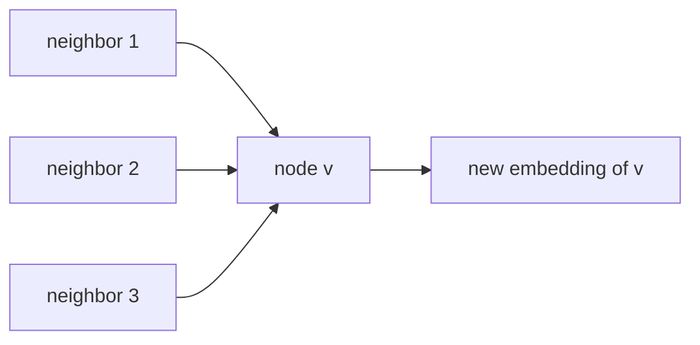

Graph neural networks (GNNs) learn from data shaped as a graph: nodes with features, connected by edges. Instead of a hand-designed score such as [[Centrality Measures]], a GNN learns a vector (embedding) for each node from the graph's structure and the node features together.

## Core Idea: Message Passing

Each layer updates a node by gathering information from its neighbors:

$$h_v^{(k+1)} = \text{UPDATE}\Big(h_v^{(k)},\ \text{AGGREGATE}\big(\{h_u^{(k)} : u \in N(v)\}\big)\Big)$$

- After $k$ layers a node's embedding reflects its **$k$-hop neighborhood**.
- AGGREGATE must not depend on the order of neighbors, since they have no natural ordering. Sum, mean, and max qualify.
- The same weights are shared across all nodes, so the model works on graphs of any size.

## Main Variants

| Model | Idea | Notes |
| ----- | ---- | ----- |
| **GCN** (Kipf and Welling, 2017) | Degree-normalized average of neighbor features, then a linear layer and nonlinearity | Motivated as a first-order approximation of spectral graph convolutions; cost grows linearly with the number of edges; designed for semi-supervised node classification |
| **GraphSAGE** (Hamilton et al., 2017) | Sample a fixed number of neighbors and aggregate their features | Inductive: embeds nodes unseen during training and even unseen graphs; scales to large graphs |
| **GAT** (Velickovic et al., 2018) | Masked self-attention over neighbors, so each neighbor gets a learned weight | Same idea as [[Attention & Transformers]]; works for transductive and inductive problems |
| **MPNN** | General message-passing framework that covers the above | Unifies GCN-style models in one formulation |

## Tasks

- **Node classification:** label nodes (fraud or not, a paper's topic), often with few labeled examples.
- **Link prediction:** predict missing or future edges (recommendation, drug-target interactions).
- **Graph classification:** pool node embeddings into one vector per graph (e.g. molecule properties).

## Connections to Network Analysis

- Centrality measures are fixed functions of structure. A GNN learns its own and can combine structure with node features.
- Bipartite graphs such as user-item networks (see [[Bipartite Networks]]) are the standard setup for graph-based recommendation, with messages passed between the two node types. See also [[Recommendation Systems]].
- A Transformer can be viewed as a GNN on a fully connected graph of tokens, with attention as the aggregation.

## Known Limitations

- **Over-smoothing:** with many layers, node embeddings become nearly identical, so most GNNs are shallow (a few layers).
- **Expressiveness:** standard message-passing GNNs cannot distinguish graphs that the Weisfeiler-Leman isomorphism test cannot.
- **Scale:** neighborhoods grow exponentially with depth, which is why sampling (GraphSAGE) is used.

## Tools

PyTorch Geometric and DGL provide GNN layers and datasets; NetworkX and Gephi are used to inspect the graphs (see [[Network Analysis Tools]]).

## Sources
- Kipf and Welling, 2017: [Semi-Supervised Classification with Graph Convolutional Networks](https://arxiv.org/abs/1609.02907)
- Hamilton et al., 2017: [Inductive Representation Learning on Large Graphs](https://arxiv.org/abs/1706.02216)
- Velickovic et al., 2018: [Graph Attention Networks](https://arxiv.org/abs/1710.10903)

*Verification: the descriptions of GCN, GraphSAGE, and GAT were checked against the paper abstracts. The generic message-passing formula, the over-smoothing and Weisfeiler-Leman limitations, the Transformer-as-GNN remark, and the tool names are standard results written from memory and not checked. Please check the sources.*

## Related Notes
- [[Neural Networks]] - Layers and training that GNNs build on.
- [[Convolutional Neural Networks]] - The grid-structured case that GCNs generalize.
- [[Centrality Measures]] - Hand-designed node importance, the non-learned counterpart.
- [[Network Analysis Tools]] - NetworkX, Gephi, and Graphviz.
