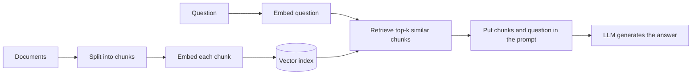
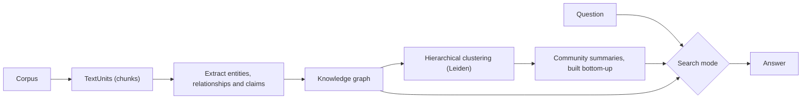

**Retrieval-augmented generation (RAG)** lets a language model look things up before it answers. Instead of relying only on what is stored in its weights, the system **retrieves** relevant passages from an external collection at inference time and gives them to the model as context. This makes answers easier to trace to a source and lets the knowledge base be updated without retraining the model ([[Large Language Models]]).

## The Original RAG Paper

Lewis et al. (2020) combined two memories:

| Component | Role |
| --------- | ---- |
| **Generator** (parametric memory) | A pretrained sequence-to-sequence model that writes the answer |
| **Retriever** (non-parametric memory) | A neural retriever over a dense vector index of Wikipedia |

The paper compared conditioning on the **same** retrieved passages for the whole output against using **different** passages for each generated token. It reported state-of-the-art results on open-domain question answering and more specific, diverse and factual generation than models using only parametric memory.

## Baseline RAG Pipeline

1. **Chunk** the documents.
2. **Embed** each chunk into a vector ([[Word Vectors]] explains the idea of embeddings).
3. **Store** the vectors in an index.
4. At question time, **embed** the question and **retrieve** the $k$ most similar chunks.
5. Put them in the prompt and **generate**.

**Weakness:** it works well for questions that point at specific passages but struggles with **global questions** about a whole collection ("What are the main themes across these documents?") and with **connecting facts** spread over many documents, because similar-looking chunks are not the same as relevant evidence.

## GraphRAG

GraphRAG (Edge et al., Microsoft, 2024, "From Local to Global") adds structure. An LLM builds a **graph index** in two stages:

1. Extract an **entity knowledge graph** from the documents.
2. Pre-generate **summaries for communities** of closely related entities.

At query time each community summary produces a **partial answer**, and the partial answers are summarized into the final response. It targets global sensemaking questions over private text collections (the paper uses corpora of about one million tokens) and reports substantial gains over conventional RAG in the comprehensiveness and diversity of answers.

### Implementation details (Microsoft's open-source GraphRAG)

| Stage | What happens |
| ----- | ------------ |
| TextUnits | The corpus is sliced into analyzable chunks that give fine-grained references |
| Extraction | Entities, relationships and key claims are extracted from each TextUnit |
| Clustering | The graph is clustered hierarchically with the **Leiden** community-detection algorithm |
| Community reports | Summaries are generated for each community and its parts, bottom-up |

| Query mode | Best for |
| ---------- | -------- |
| **Global Search** | Holistic questions about the corpus, answered from community summaries |
| **Local Search** | Specific entities, fanning out to their neighbours and related concepts |
| **DRIFT Search** | Local search enriched with community information |
| **Basic Search** | Plain top-k vector search, which is baseline RAG, for queries it suits |

## Baseline RAG vs. GraphRAG

| | Baseline RAG | GraphRAG |
| --- | ------------ | -------- |
| Index | Vector index of chunks | Knowledge graph plus community summaries |
| Good at | Questions answered by a few specific passages | Corpus-wide themes and linking scattered facts |
| Indexing work | Embed the chunks | LLM extraction and summarization over the whole corpus (more work, which I expect to cost more) |
| Evidence | Retrieved chunks | Entities, relationships and summaries |

The GraphRAG documentation describes the benefit for global questions but gives no cost figures or benchmarks, so the claims of large gains are the authors' and are not independently checked here. The extra indexing cost is my inference from the pipeline, since every chunk needs LLM calls.

## Links to Graph Methods

The graph machinery in GraphRAG is ordinary network analysis: **communities**, neighbourhoods and the importance of nodes over an entity graph ([[Centrality Measures]], [[Graph Neural Networks]]). A related idea in agent systems is the context graph ([[Context Graphs]]).

*Sources: [Lewis et al., Retrieval-Augmented Generation for Knowledge-Intensive NLP Tasks (2020)](https://arxiv.org/abs/2005.11401); [Edge et al., From Local to Global: A Graph RAG Approach to Query-Focused Summarization (2024)](https://arxiv.org/abs/2404.16130); [Microsoft GraphRAG documentation](https://microsoft.github.io/graphrag/), which I read for the pipeline stages and query modes. The baseline pipeline is standard background.*

---
*Related:* [[Natural Language Processing MOC]], [[Large Language Models]], [[Context Graphs]], [[Word Vectors]]
