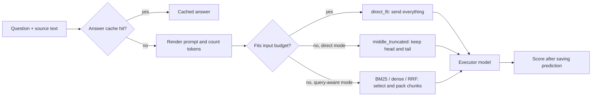

> An execution layer that sends a long document to an LLM whole when it fits and, when it does not, rebuilds the input from the chunks that match the question, kept in source order.

## Quick Facts
- **Context:** Research under Prof. William Eiers (06/2026 – present). Formerly "LLM Caching & Recursive Language Models (RLMs)"; renamed in October 2026 because the work is no longer about RLMs and the focus moved from the cache to retrieval under a context budget.
- **Tech Stack:** Python, vLLM, Qwen3.6-35B-A3B (executor), BM25, Qwen3-Embedding-0.6B, FAISS, Slurm
- **Links:** [GitHub](https://github.com/adarsh-vatsa/RLMs)

## Overview and Problem
Long-context questions often come with more source text than a model can take in. The research question: compared with sending the full context to the same model, does retrieval under a token budget keep or improve accuracy while using fewer tokens and less time? The project began in June 2026 as a Two-Stage Semantic Cache prototype on Claude models and now runs every experiment on a locally served open-weight model across three long-context benchmarks.

## What I Built
- **Engineered** a benchmark-agnostic `Pipeline` that counts tokens on the fully rendered request with the served model's tokenizer and chat template. Inputs that fit go through unchanged; longer ones are cut with middle truncation or rebuilt by query-aware selection.
- **Implemented** three query-aware selectors: BM25, dense (Qwen3-Embedding-0.6B with FAISS), and reciprocal-rank fusion of the two, with neighbor expansion, fill packing up to the budget, a per-document floor, and source order restored.
- **Designed** small task adapters (documents, question, `render` function) so AA-LCR, MRCR v2 and LongBench-v2 run through one pipeline, with gold answers kept out of solver inputs.
- **Prototyped** a FAISS semantic answer cache with an LLM equivalence verifier, which cut token usage by **49%** on original and paraphrased LongBench-v2 questions.
- **Pre-registered** the conditions and primary comparisons in a plan before any reported run, with Holm-corrected tests and a hand-audited LLM judge.
- **Automated** **93 experimental conditions** on two GPU setups: a single 96 GB RTX PRO 6000 and a Slurm cluster of 4x L40S nodes, with preflight routing reports, dry-run launchers and **264 unit tests**.

**Architecture overview**

## Key Results and Impact
All runs use Qwen3.6-35B-A3B, temperature 0, thinking disabled, as a single run per setting.

**AA-LCR** (100 questions, 88K-122K token prompts):

| Run | Window / input budget | Accuracy |
|---|---|---:|
| Full context | 262,144 / 258,048 | 65% |
| Query-aware truncation | 65,536 / 61,440 | 64% |
| Middle truncation | 65,536 / 61,440 | 40% |

- Achieved **+24 points** for query-aware retrieval over truncation at the same 64K window (40% to 64%); query-aware truncation is level with full context (65%) on **42% fewer input tokens**.
- Answers are scored by an LLM judge whose verdicts were audited by hand.

**MRCR v2** (4-needle release, deterministic exact-match scoring):

| Setting | Middle truncation | Query-aware |
|---|---:|---:|
| 262K window, all conversations | 38% | **62%** (equal to oracle) |
| 533K-token conversations | 27% | **70%** |
| 1.06M-token conversations | 10% | **63%** |

- Raised exact match from **38% to 62%** at 262K, matching an oracle that always keeps the needed text.
- Showed that the cost of middle truncation grows with how much it cuts: the longer the conversation, the more needles truncation drops, while query-aware selection holds up.

**LongBench-v2**: full context beats middle truncation by only 5.9 points, so there is little to recover, and the query-aware gains were not significant after Holm correction.

## Core Learnings
- Query-aware selection pays off in proportion to how much truncation would cut; on prompts that fit, every condition sends the identical request.
- Budget flags do not change the server: vLLM fixes the served window at launch, so the runner's budget must stay within it.
- A run in which every request fails can still finish with a score of 0 unless it fails fast, and an unaudited LLM judge inflates confidence in absolute scores.
- Fixing conditions and comparisons before running, then correcting for multiple tests, keeps a 93-condition sweep from turning into a search for significant results.

---
*Related:* [[Projects/index|Projects MOC]], [[LM Benchmarks]], [[KV Cache]], [[Agentic Information Traversal]]
