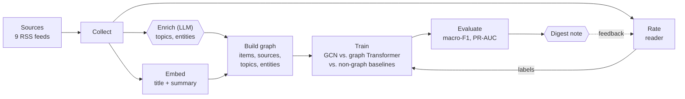

> A personal news digest that turns a reader's chosen RSS feeds into a knowledge graph of items, sources and entities, then learns from the reader's own ratings which new items are worth reading.

## Quick Facts
- **Context:** EM 626 AI and ML for Systems, Fall 2026 course project (Stevens Institute of Technology), solo. In progress: midterm presented November 9, 2026; final presentation December 14, 2026.
- **Tech Stack:** **Python 3.12** with **uv**, **feedparser**, **trafilatura**, LLM entity extraction (**GLM 5.3 Flash via OpenRouter**), **PyTorch Geometric** `HeteroData`, **NetworkX**, pandas, matplotlib, pytest; planned **sentence-transformers** embeddings, GCN/GraphSAGE, HGT/TransformerConv, scikit-learn baselines, Streamlit rating form
- **Links:** [GitHub Repo](https://github.com/engindenizdogu/personal-news)

## Overview and Problem
Feed readers such as Inoreader, NewsBlur and rss.app solve collection, but the reader still has to filter hundreds of items by hand or maintain manual filters. The project builds a recommender that sorts incoming items into **More like this**, **Neutral** and **Less like this**, using only the reader's own ratings, with no profile or personal data. The research question is whether graph structure (items linked through shared entities, topics and sources) improves relevance prediction over item text alone. Background: [[Graph Neural Networks]].

*Hexagons are LLM calls; rectangles are code or the reader.*

## What I Built
Status as of the midterm (November 2026), as modules in `src/pnews/`:
- **Engineered** an idempotent feed collector (`pnews.collect`) over 9 hand-picked feeds (OpenAI News, The Pragmatic Engineer, Stripe, Cloudflare, Google DeepMind, BBC News US and Canada, Coding Horror, Nature, HackerNoon). Each item is keyed by a 16-character hash of its normalized URL, the ID every later stage uses. About 1,500 items were fetched; filtering to items published in 2026 or later left **824**.
- **Implemented** polite article extraction (`pnews.content`) with trafilatura: respects `robots.txt`, one request per host per second, 20 s timeout, 5 MB page cap, and an explicit status per item (`ok`, `too_short`, `robots_disallowed`, and others). A 45-item sample (5 per source) feeds the midterm graph.
- **Built** validated LLM entity extraction (`pnews.enrich`) for organizations, people, products and locations: temperature 0, fixed seed, JSON mode, input capped at 2,500 words. Code checks reject invalid JSON (one retry, then a fallback), drop any entity whose mention does not appear in the text as a whole word, and merge aliases. Every answer is cached by input hash, so re-runs and rule changes cost no new API calls. Total cost: about **$0.016 for 45 items** (about $0.0004 per item).
- **Constructed** a deterministic heterogeneous graph (`pnews.graph`) saved as PyG `HeteroData`, with statistics tables, figures, and a GEXF export for browsing in Gephi. A statistics notebook adds centrality, a source-homophily permutation test, and chi-square tests.
- **Documented** prompts, LLM-generated versus handwritten components, and a validation log of test inputs, expected versus actual output, and fixes, as the course requires.

![[personal-news-graph-v0.png]]
*Graph v0: blue circles are items, orange squares are sources, green triangles are entities shared by two or more items.*

Planned for the final phase:
- **Scale** to about 25 sources and 1,000 items; freeze a list of about 30 topics from free-form LLM tags and add topic nodes and optional item-to-item similarity edges.
- **Label** items through a Streamlit rating form that shows only title, source and summary, in random order, with timestamps.
- **Train** GCN or GraphSAGE and HGT or TransformerConv on embedded item nodes against logistic regression, random forest, gradient-boosted trees and label propagation, with ablations by edge type and attention-based explanations.
- **Generate** a plain-English digest note drafted by an LLM from model outputs only and checked claim by claim.

## Key Results and Impact
- Achieved a reproducible pipeline from raw feeds to a graph of **780 nodes** (45 items, 9 sources, 726 entities) and **902 edges** (45 item-to-source, 857 item-to-entity) at negligible LLM cost.
- Measured graph sparsity as the main early risk: **90% of entities** (654 of 726) appear in one item only, and only 2.5% of person entities appear in two or more. The median item mentions 12 entities.
- Showed the graph still connects most items: **164 item pairs** share at least one entity (107 across different sources), 39 of 45 items have such a link, and the largest linked group holds 37 items. Cross-source links come mostly from a few hubs: United States (10 items, 5 sources), OpenAI (9), Stripe (7), and Anthropic, Cloudflare and Meta (6 each).
- Planned evaluation: **macro-F1 and PR-AUC** (relevant items are rare) on a time-based train/validation/test split, reported as mean and standard deviation over 5+ seeds.

## Core Learnings
- Entity graphs from news are sparse and long-tailed: most people and products appear once, so higher-level nodes (topics, organizations) and alias merging matter more than extraction volume.
- Cheap LLMs work for structured extraction when code enforces the contract: schema checks, a mention-in-text check against hallucinated entities, and an input-hash cache for reproducibility.
- Leakage control drives the design: features never include ratings, the topic list comes from item text only, and splits follow publish time so the model never trains on newer stories than it predicts.

---
*Related:* [[Projects/index|Projects MOC]] | [[Graph Neural Networks]] | [[Automatic Tag Generation and Clustering with LLMs]]
