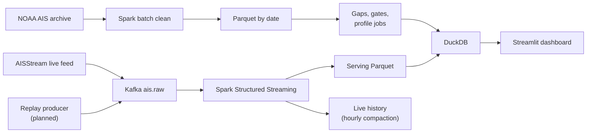

> A transportation analytics web app (vessel-watch) that tracks ship traffic in New York Harbor from public AIS position reports, forecasts inbound ships at the harbor entrance, and flags vessels whose signal goes dark.

## Quick Facts
- **Context:** AAI 627 Big Data Analytics for Engineering Design, Fall 2026 course project (Option 1: build a big data analytics app). In progress; due in the first week of December 2026, with a feature freeze on November 15.
- **Tech Stack:** Python 3.11 with uv, **Apache Spark 3.5** (batch and Structured Streaming, Java 17), **Apache Kafka** (single broker, KRaft, Docker Compose), Parquet, **DuckDB**, pandas, **Streamlit** with pydeck, scikit-learn/LightGBM (planned), pytest, Makefile, Cloudflare Quick Tunnel
- **Data:** NOAA/BOEM MarineCadastre AIS archive (historical, daily CSVs of about 1 GB each) and the AISStream live WebSocket feed
- **Links:** [GitHub Repo](https://github.com/engindenizdogu/vessel-watch)

## Overview and Problem
Vessels broadcast AIS position reports every few seconds to minutes, producing a large, noisy, fast-moving dataset. The goal is a pipeline that cleans historical and live AIS data with Spark, forecasts hourly inbound ship traffic, and raises alerts for signal gaps and off-route movement, all shown on an interactive dashboard. Related background: [[Apache Spark]], [[Stream Processing and Event Streaming]], [[Correlation Drift Monitoring with Spark]].

## What I Built
Status as of November 6, 2026 (weeks 1 to 3 of 7 done):
- **Engineered** a resumable NOAA history pipeline (`make history`) that samples random blocks of consecutive days, then downloads, cleans and deletes one raw day at a time, so only about 1.4 GB of raw data is on disk at once. Result: **58 days, 15.6 million reports, 247 MB** of date-partitioned Parquet.
- **Implemented** one shared cleaning module for batch and streaming: crop to the harbor box, drop invalid MMSIs and out-of-range positions, null AIS "not available" codes (heading 511, speed 102.3), deduplicate, and drop position spikes only when the implied speed is impossible from both neighbors. Row counts are logged after each step.
- **Built** the live path: an AISStream producer into Kafka (keyed by vessel), Spark Structured Streaming into serving Parquet (one file per 60-second micro-batch to avoid small files), and a second query that keeps every live report and compacts it hourly into one cleaned file per day.
- **Designed** a calibrated signal-gap detector: a vessel that was reporting regularly goes silent longer than the larger of a state minimum (10 min moving, 30 min stopped) and 8 times its recent median interval. It skips vessels near the box edge and never raises gaps across feed outages (1,134 outage minutes found in the archive). On 58 days it found **7,882 gaps from 525 vessels**; 6,368 started at one of **119 learned shutdown spots** (ferries and tour boats switching AIS off at the berth), leaving 1,514 worth a look.
- **Replaced** terminal geofences with **gate crossings** as the forecast target after terminal arrivals proved too sparse (0.28 per hour at Port Newark). Four gate lines (sea entrance, the Narrows, Throgs Neck, George Washington Bridge) count crossings by direction and vessel group; the target is inbound cargo ships and tankers at the sea entrance: **11.9 per day, 0.49 per hour, 63% of hours zero**.
- **Delivered** a Streamlit dashboard with Live (positions from the last 15 minutes, refreshed every 30 s), History (any NOAA day with a Play button and vessels-per-hour chart) and Data Dictionary pages, plus a public demo link through a Cloudflare Quick Tunnel. Covered by **72 pytest tests**.

Planned (weeks 4 to 7):
- **Build** a replay producer and a stateful streaming gap detector (`applyInPandasWithState`) that must reproduce the batch gaps on replayed NOAA days.
- **Train** the inbound-ship forecast against a seasonal-naive baseline (also testing 3-hour bins, since the hourly target is sparse) and add off-route alerts from a traffic-density grid.
- **Evaluate** both detectors on injected anomalies (detection and false-alert rates), optionally against an isolation forest, then integrate the live map, forecast chart and alert feed.

## Key Results and Impact
- Achieved a working end-to-end batch and live pipeline over **15.6 million reports** with a public demo link, ahead of the week 5 integration milestone.
- Cut alert noise by labeling gaps at learned shutdown spots: on a time split (spots learned from 2023, applied to 16 days of 2024), **87% of berth shutdowns** (1,631 of 1,877) were labeled while **89% of real moving gaps** (314 of 351) stayed unlabeled, leaving about 48 unexplained gaps per day.
- Validated the data coverage: gate lines seal their channels (extending any line by 25% adds no cargo ships; cargo crossings balance 474 in and 474 out), and reception does not drop near the box edges (median report interval 70 s within 2 km of an edge vs. 67 s inside).
- Targets still to measure: beat the seasonal-naive baseline on held-out MAE with a time-based split, and report detection and false-alert rates on injected anomalies.

## Core Learnings
- Calibrate definitions on data, not intuition: the declared navigational status was unreliable (most "under way" gaps were vessels doing under 1 knot), so the gap rule uses speed instead.
- Most "anomalies" in raw AIS are expected behavior; learning where vessels routinely go silent matters more than a tighter threshold.
- A sparse target (63% zero hours) can sink a forecast, so switching from terminal arrivals to entrance gate crossings was worth a day of rework.
- Keying Kafka messages by vessel keeps per-vessel ordering, and one cleaning module shared by batch and streaming avoids training-serving skew.

---
*Related:* [[Projects/index|Projects MOC]] | [[Apache Spark]] | [[Stream Processing and Event Streaming]]
