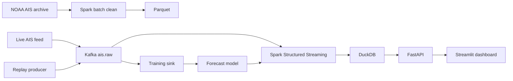

> A transportation analytics web app that forecasts vessel arrivals and flags signal gaps and off-route movement in New York Harbor from public AIS position reports.

## Quick Facts
- **Context:** AAI 627 Big Data Analytics for Engineering Design, Fall 2026 course project (Option 1: build a big data analytics app). In progress; due in the first week of December 2026 (exact date unconfirmed).
- **Tech Stack:** Python 3.10/3.11, **Apache Spark 3.5** (batch and Structured Streaming), **Apache Kafka** (single broker, KRaft, Docker), Parquet, DuckDB, scikit-learn/LightGBM, FastAPI, Streamlit with pydeck
- **Data:** NOAA/BOEM MarineCadastre AIS archive (historical) and a free live AIS WebSocket feed (to be confirmed for harbor coverage)
- **Links:** None yet; a project plan and repo-level CLAUDE.md were drafted separately and the repository is being set up

## Overview and Problem
Vessels broadcast AIS position reports continuously, producing a large, noisy, fast-moving dataset. The goal is a pipeline that cleans historical and live AIS data with Spark, forecasts hourly vessel arrivals, and raises alerts for signal gaps and off-route vessels, all shown on an interactive dashboard with a live map, a forecast chart, and an alert feed. Related background: [[Apache Spark]], [[Stream Processing and Event Streaming]], [[Correlation Drift Monitoring with Spark]].

## What I Built
Planned components (build under way, status as of October 2026):
- **Engineer** a Spark batch pipeline that cleans NOAA AIS data (invalid MMSI, out-of-range coordinates, duplicates, impossible speeds) into date-partitioned Parquet.
- **Implement** a Kafka ingestion path (included deliberately to learn the technology): a live WebSocket producer and a replay producer share one topic (`ais.raw`, keyed by MMSI), consumed by Spark Structured Streaming.
- **Build** a training-data branch: a second consumer group writes features to Parquet for offline model training.
- **Train** an arrival forecast (hourly arrivals per geofence) against a seasonal-naive baseline using time-based splits.
- **Design** anomaly detection: a signal-gap rule and an off-route check against a density grid learned from history, evaluated on injected anomalies; an isolation forest on per-vessel features is an optional stretch for comparison with the rules.
- **Deliver** a Streamlit dashboard with live map, forecast chart, and alert feed over a thin FastAPI layer.

## Key Results and Impact
Targets (not yet measured):
- Aim to **beat a seasonal-naive baseline** on held-out MAE for hourly arrivals, using a time-based train/test split.
- Measure **detection rate and false-alert rate** for gap and off-route alerts on injected test anomalies, since real labels do not exist.
- Keep **one cleaning and feature code path** shared by replay, live, and training to avoid training-serving skew.
- Gate each phase with data checks: usable report density by Oct 25, Kafka reading into Spark by Oct 30, feature freeze Nov 15.

## Schedule

| Week | Dates | Focus | Deliverable |
| :-- | :-- | :-- | :-- |
| 1 | Oct 19-25 | Data access, definitions, first preprocessing | Project repo and environment setup; test the data source (sample set, first cleaned Parquet); "arrival" and "anomaly" defined |
| 2 | Oct 26-Nov 1 | Kafka setup, historical pipeline | Kafka broker and Spark pipeline; replay feed for Spark |
| 3 | Nov 2-8 | Live ingestion, arrival forecast | Live Kafka producer on the live AIS feed (the replay producer already covers the dataset); naive baselines: seasonal-naive for the arrival forecast, rule-based for anomalies, used for comparing model results |
| 4 | Nov 9-15 | Anomaly detection | Model training pipeline (separate consumer to Parquet, offline training) and an arrival forecast beating the baseline; anomaly detector with signal-gap and off-route alerts, detection and false-alert rates measured on injected test anomalies; **no new features after Nov 15** |
| 5 | Nov 16-22 | Dashboard and integration | Live map, forecast chart, alert feed, working end to end |
| 6 | Nov 23-29 | Final checks and writeup | Results, architecture diagram, rehearsed demo |
| 7 | Nov 30-Dec 6 | Buffer week | Final fixes and submission |

If time runs short, cut in this order: off-route alerts (keep the signal-gap rule), then live feed (demo from replay), then forecast tuning.

## Core Learnings
- Trade-offs between a live feed and a replay path: replay makes demos and anomaly tests reproducible, while live data proves the architecture.
- Keying Kafka messages by vessel keeps per-vessel ordering, which gap detection depends on.
- With no ground-truth labels, injected anomalies and a naive baseline are what make the evaluation defensible.

---
*Related:* [[Projects/index|Projects MOC]]
