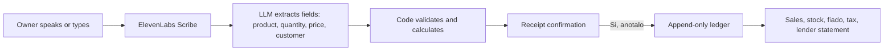

> A voice-first cash register for cash-based businesses such as New York bodegas: the owner says what happened, confirms a receipt, and sales, stock, credit, and tax update together.

## Quick Facts
- **Context:** Latinos x AI Hackathon NYC (one-day build, October 2026), team project with Siddhant Rajhans and Gabriel Reynoso Romero
- **Tech Stack:** Base44 (app, data, backend functions), ElevenLabs Scribe (speech-to-text and voice replies, with browser speech as backup)
- **Links:** [Devpost](https://devpost.com/software/gsd-vmh319) | [Live App](https://palapa.base44.app/) | [GitHub Repo](https://github.com/siddhant-rajhans/palapa) | [Demo Video](https://siddhant-rajhans.github.io/palapa/video.html) | [Pitch Deck](https://siddhant-rajhans.github.io/palapa/deck/Palapa-deck.pdf) | [LinkedIn Post](https://www.linkedin.com/posts/engindenizdogu_latinosintech-ai-hackathon-share-7514775424241950720-aAdd/)

## Overview and Problem
Corner stores in New York run on cash and a paper notebook: sales, deliveries, and "fiado", the store credit owners give neighbors who pay later. Owners cannot type while serving customers, credit gets lost, stock runs out unnoticed, and without records there is no proof of income for a loan or a lease. In the US, 9.5% of Hispanic households have no bank account, compared with 1.9% of White households (FDIC, 2023).

## What I Built
- **Engineered** a voice-first register where the owner speaks or types a sale in Spanish, English, or both, and sees a receipt-style confirmation ("¿Así fue?") before anything is saved.
- **Implemented** a strict split between language and arithmetic: the AI only turns a sentence into fields (product, quantity, price, customer), and plain code validates them and calculates every dollar.
- **Designed** an append-only ledger in which entries are never edited, undo marks a line as undone, and each entry keeps its price, cost, and tax.
- **Built** modules for home totals and low-stock alerts, fiado balances and payments, inventory with voice vocabulary, and a one-page monthly lender statement in Spanish or English as PDF or Excel.
- **Compiled** a compliance guide ("Trámites") of tax forms, registrations, licenses, and deadlines from 31 official IRS, New York State, and New York City items, with deadlines that update as the owner answers.
- **Delivered** nine interface languages, including Arabic right to left.

**Architecture overview**

## Key Results and Impact
- Produced a lender statement whose numbers match a hand calculation ($258.00 sales, $248.50 collected, $13.84 tax).
- Shipped a working app and compliance guide in one day, with September numbers verified by hand to the cent.
- Handled sales tax by business location (NYC 8.875% by default), with tax-included pricing and a per-product taxable switch.

## Core Learnings
- Separate understanding language from counting money: keeping the AI away from arithmetic made every figure auditable.
- Design for busy hands: big type, voice first, and one clear confirmation step.
- Be honest about credit: the lender statement is self-reported until a lender validates it.
- Next steps: a pilot with one bodega owner, validating the statement with a credit union or CDFI, text alerts through Twilio, WhatsApp voice notes, and supplier reorders.

---
*Related:* [[Projects MOC]]
