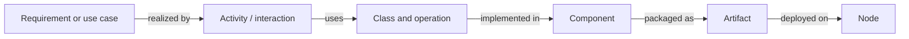

Model-based systems engineering (MBSE) treats the **system model**, not a pile of documents, as the primary artifact of engineering work. Requirements, structure, behavior, and deployment all live in one connected model, and documents or diagrams are views generated from it. The payoff is that the model can be queried, checked, and analyzed by tools, which is impossible with prose specifications.

## From Documents to Models

| Document-centric | Model-centric (MBSE) |
| ---------------- | -------------------- |
| Requirements in Word or PDF files | Requirements are model elements with IDs |
| Diagrams drawn by hand, detached from the text | Diagrams are views of one shared model |
| Consistency checked by reading | Consistency checked by tools and queries |
| Change means editing many files | Change means editing one element |

## Modeling Languages

**UML** (Unified Modeling Language) is the general-purpose software modeling language. **SysML** (Systems Modeling Language) is a UML profile adapted for systems that mix hardware, software, and people; both are standards of the Object Management Group (OMG). Common diagram types:

| Diagram | What it shows |
| ------- | ------------- |
| Use case | Actors and the goals they pursue with the system |
| Class | Types, attributes, operations, and their relationships |
| Activity | Flow of steps, decisions, forks, and joins (control flow) |
| Sequence | Messages exchanged between lifelines over time |
| State machine | States, transitions, and triggers of one element |
| Component | Replaceable parts and their interfaces |
| Deployment | Which artifacts run on which nodes |

The chain above is **traceability**: a link from a requirement or use case to whatever realizes it, down to the deployed artifact. A model with broken traceability is the MBSE equivalent of a requirement nobody implemented.

## XMI: the Interchange Format

Modeling tools such as Cameo Systems Modeler (formerly MagicDraw) store models in tool-specific formats. **XMI** (XML Metadata Interchange, also an OMG standard) is the XML format meant to move a model between tools. An XMI export is a flat list of elements, each with an ID, and relationships refer to other elements by ID. Reading it programmatically means parsing the XML and following those ID references.

Not every XMI record is a "thing in the system". Typical roles:

- **System elements:** actors, use cases, classes, components, activity steps. These become nodes if the model is turned into a graph.
- **Relationships:** associations, messages, control flows. These become edges.
- **Supporting records:** lifelines, message events, association ends. They exist to tie other elements together and are followed to their real endpoints.
- **Detail records:** multiplicities, state triggers, guard text. Useful as attributes, not as nodes.
- **Presentation and profile data:** diagram layout and stereotypes describe how the tool draws the model, not the system itself.

### Resolving a Sequence Diagram

Sequence diagrams do not link classes directly. A message points to a send event and a receive event, each event points to a lifeline, a lifeline points to the role it represents, and the role has a type, which is a class:

`message` -> `event` -> `lifeline` -> `role` -> `class`

Following this chain is what ties interactions to the class model.

## Example: an Inventory-Control System Model

A specification model of an inventory-control system exported as XMI contained **416 elements with IDs**:

| Group | Count | Treatment |
| ----- | ----- | --------- |
| Things in the system (actors, use cases, classes, components, activity steps) | 110 | Graph nodes |
| Relationships (associations, messages, control flows) | 113 | Graph edges |
| Supporting records (lifelines, message events, association ends) | 127 | Followed to real endpoints, then dropped |
| Detail records (multiplicities, state triggers) | 65 | Not in the graph; guard text kept on control-flow edges |

The root model wrapper was left out on purpose, since it would connect every view through one node and hide the parts that are actually disconnected.

Typical findings when reviewing such a model:

- Six disconnected pieces: no trace links from use cases to what realizes them.
- 4 of 6 use cases had no activity or interaction behind them.
- Two interactions disagreed on which class triggers the same operation.
- An actor linked to nothing; a component with no artifact, so it is never deployed.
- Dependencies present at the artifact level but missing at the component level (layers disagree).
- Style problems: actors named like processes instead of roles, merges drawn as decision nodes, a join drawn as a fork, and vague guards such as "yes", "no", "proceed".

These checks can be automated once the model is a graph. See [[Specification Models as Graphs]].

## Sources
- OMG: [SysML specification](https://www.omg.org/spec/SysML/), [UML specification](https://www.omg.org/spec/UML/), [XMI specification](https://www.omg.org/spec/XMI/)
- Element counts and findings come from the author's analysis of one example model.

*Verification: definitions of MBSE, SysML/UML, and XMI are standard descriptions written without re-fetching the specifications. The OMG links point to the specification landing pages; please check them.*

## Related Notes
- [[Specification Models as Graphs]] - Turning an XMI model into a graph and checking it with rules.
- [[Graph Neural Networks]] - Learning on the resulting graph.
- [[Network Analysis Tools]] - NetworkX for building and inspecting the graph.
